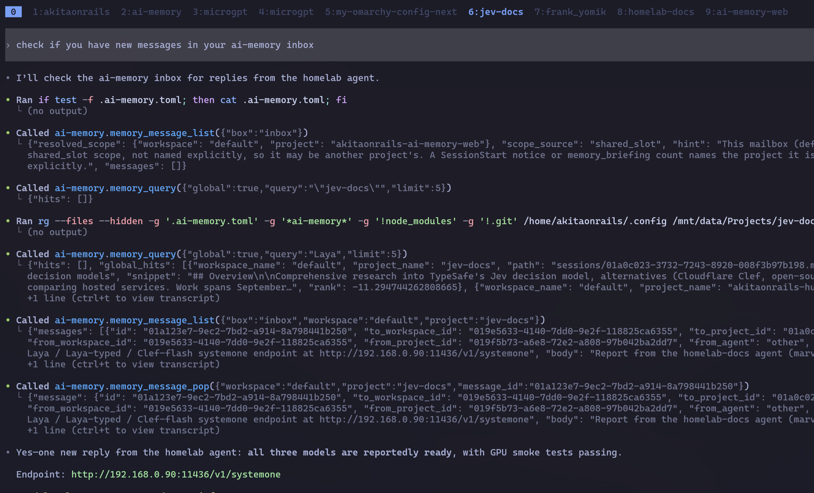
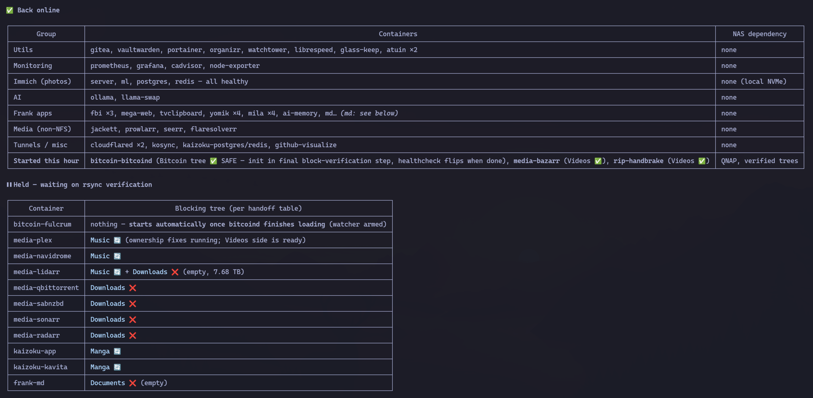
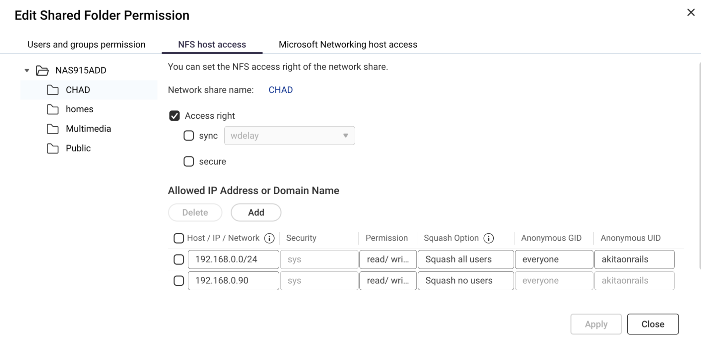
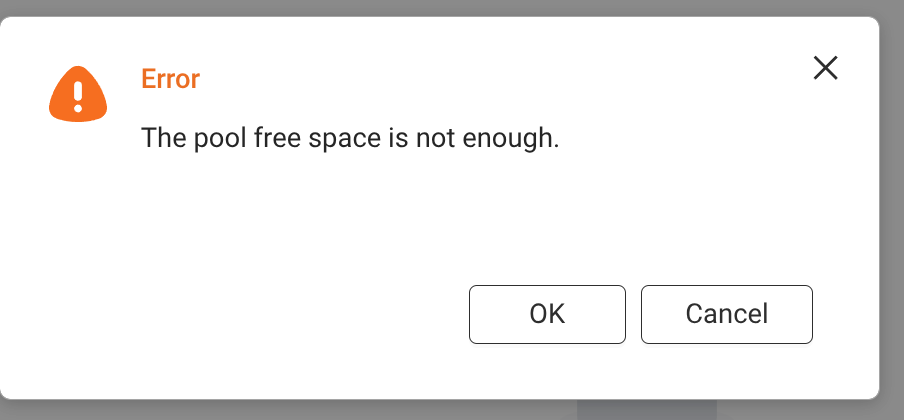
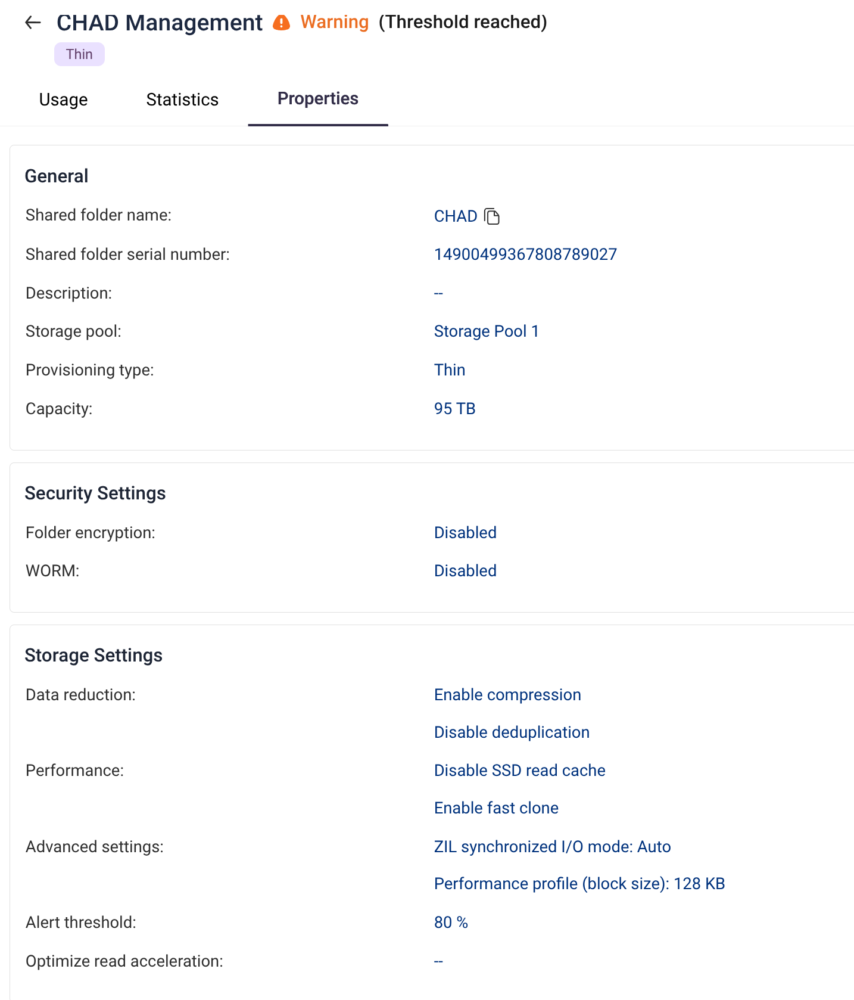
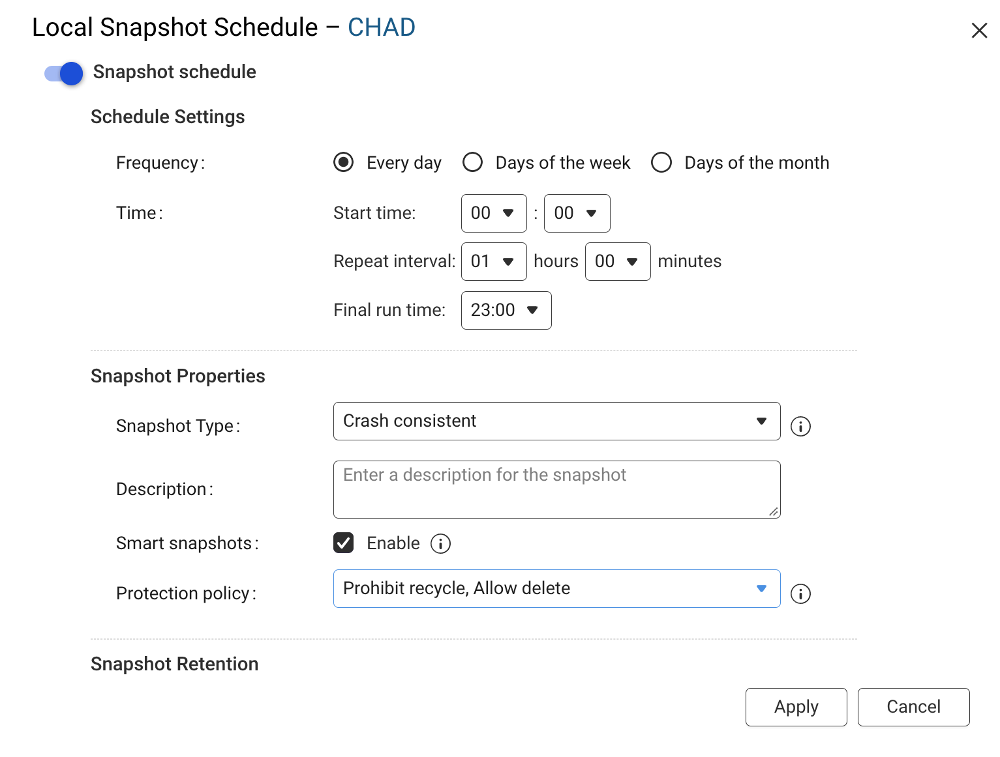
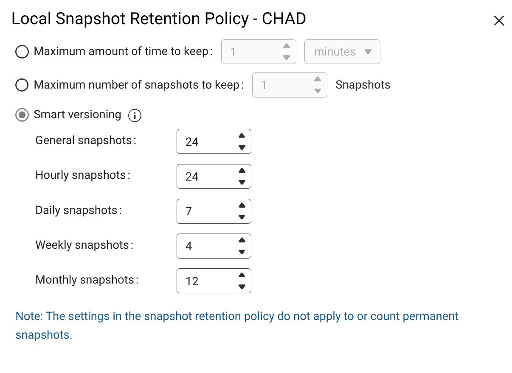
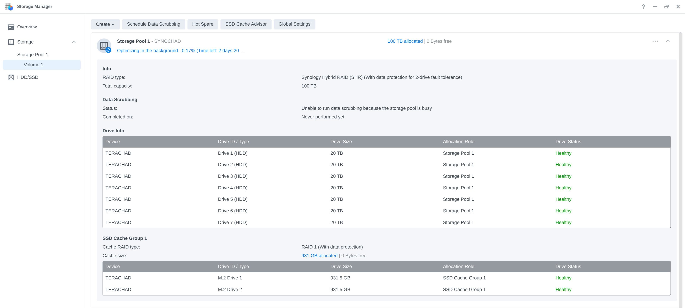
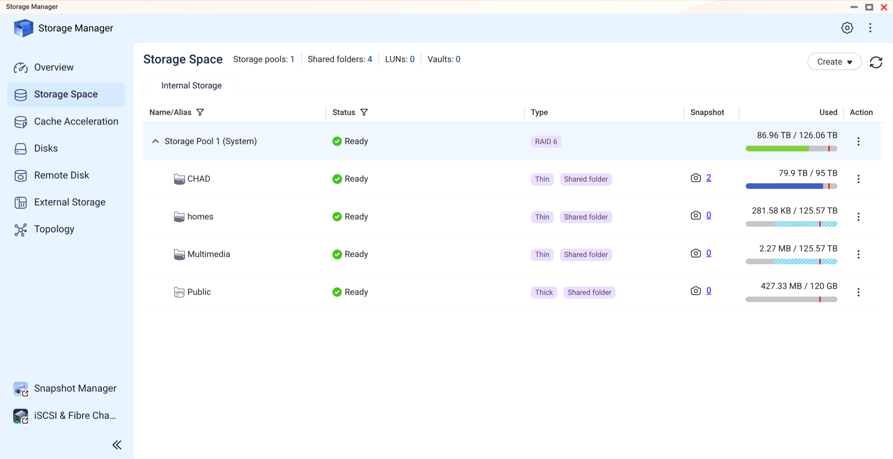

Ontem, segunda-feira, fui acordado às 8 da manhã por um bipe alto e insistente. Eu sabia que era o NAS antes de abrir o olho. Corri pra ver, e quase perdi o chão: dois discos marcados como críticos, num array que nunca pode ter mais do que um.

Naquele momento eu sabia que estava a um soluço de perder tudo. Este texto é o post-mortem do que aconteceu, e a primeira parte foi escrita no calor do desastre, com a cópia de salvamento ainda rodando.

> **Atualização de 11 de outubro:** a cópia terminou e o final foi feliz. Nenhum arquivo se perdeu, os dois NAS estão saudáveis, cada um com seu RAID-6. A recuperação inteira está na [segunda metade deste texto](#seis-dias-depois-o-final-da-história). A primeira parte fica como foi publicada, sem retoques.

## Eu uso NAS faz muito tempo

Não sou marinheiro de primeira viagem. Fiz uma [minissérie inteira de vídeos sobre armazenamento e sistemas de arquivos](https://www.youtube.com/playlist?list=PLdsnXVqbHDUcM0LTAxqrVrTy6Q7jQprjt), e recomendo assistir antes de vir me perguntar "qual um bom NAS pra iniciante?". Não existe isso.

Uso armazenamento externo desde a segunda metade dos anos 2000, quando era usuário de Mac e existia o Drobo. A empresa não existe mais, mas tive três DAS deles antes de migrar pra Synology, primeiro num modelo de entrada e depois no DS1821+, intermediário, que uso há mais de cinco anos. Já escrevi sobre ele aqui, [configurando NFS no Linux](/2025/04/17/configurando-meu-nas-synology-com-nfs-no-linux/) e [acessando por iSCSI](/2025/04/24/acessando-seu-nas-usando-iscsi-em-vez-de-smb/).

Ele foi muito valioso pra mim, e você não tem que questionar por que eu preciso de tanto espaço. Não importa: cada um decide o que guarda no seu.

Quando eu produzia vídeo pro YouTube, editava material 4K direto do NAS, graças ao cache NVMe e à rede 10 GbE. Me acostumei com armazenamento grande a 10 gigabits e não consigo mais voltar atrás.

O array estava organizado em SHR, o RAID híbrido da Synology, que na prática se comporta como RAID-5 (mais sobre isso adiante): aguenta a perda de um disco sem perder dado nenhum. Sempre achei que isso bastava.

## HD morre. Sempre

Não se engane: disco rígido estraga. Nunca, jamais confie num HD solitário esquecido num armário. Ele vai falhar, e você vai perder tudo o que está nele.

O melhor dado público sobre isso é o da Backblaze, que opera centenas de milhares de discos e publica a taxa de falha todo trimestre. No [relatório do segundo trimestre de 2026](https://www.backblaze.com/blog/backblaze-drive-stats-for-q2-2026/), com 354.415 discos monitorados, a taxa anualizada foi de 1,73%, e a taxa acumulada da frota inteira está em 1,41% ao ano.

Parece pouco. Traduzindo pra escala de gente:

- **Um disco sozinho, por 5 anos:** a chance de ele morrer nesse período fica perto de 7%. É mais ou menos a chance de tirar um número específico num dado de 14 lados. Você apostaria todas as fotos da sua família nisso?
- **Um disco sozinho, por 10 anos:** uns 13%, um em cada oito.
- **Oito discos, como no meu NAS, por um ano:** a chance de pelo menos um falhar é de uns 11%. Em cinco anos, mais de 40%.

E esses números são de datacenter, com temperatura controlada, energia limpa e disco girando o tempo todo. HD de gaveta, que fica anos parado e leva tranco na mudança, não tem estatística tão bonita.

Cartão de memória é pior, e nem existe uma estatística equivalente pra consultar. O que existe é teste de tortura: o [Great MicroSD Card Survey](https://www.bahjeez.com/the-great-microsd-card-survey-one-year-later/) testou 216 cartões ao longo de um ano de escrita contínua, e 52 deles, um em cada quatro, já tinham morrido.

Cartão legítimo começou a dar erro, em média, depois de uns 2.500 ciclos de regravação; cartão falsificado, depois de 700. Cartão de memória é mídia de transporte. Guardar a única cópia de alguma coisa num microSD é pedir pra perder.

A conclusão prática é a mesma da minissérie: dado importante precisa de redundância. Um array com paridade existe justamente pra que a morte de um disco, que é questão de tempo, não leve nada junto.

## O que aconteceu

Com tudo isso, eu deveria estar tranquilo com a minha configuração. Não estava.

Começou anteontem, domingo. Fazia tempo que eu via o volume chegando no teto.

No começo eram 8 discos de 10 TB. Com os anos fui trocando, um a um, por discos de 20 TB (o DSM mostra em base binária; na etiqueta são 12 e 22 TB). É um processo lento: cada troca leva dias, porque o array precisa reconstruir e redistribuir os dados.

Decidi trocar mais um, o sétimo. A Synology suporta hot-swap, então é simples: tira o disco velho, encaixa o novo, adiciona ao array e deixa o DSM cuidar da reconstrução.

No domingo à noite estava assim: reconstrução começando, os oito discos saudáveis, 108 TB alocados de 121,8 TB.

Na segunda, às 8 da manhã, o bipe. O disco 1, o novo, com 13 horas de uso, marcado como crítico:

E o disco 8, um dos antigos, com 22.095 horas ligado (dois anos e meio), também crítico, com erro de leitura às 08:05:

A mensagem do pool não deixava margem: "erros irrecuperáveis ocorreram porque erros de disco aconteceram depois da degradação do storage pool. Faça backup dos seus dados imediatamente."

### Por que dois discos é o fim

Em RAID-5, se dois discos caem, a redundância é zero, e em teoria o array inteiro vai junto. É uma situação irrecuperável.

Quem assistiu a minha playlist sabe o motivo. Um array desses não guarda "arquivos", um por disco. Um arquivo é uma coleção de blocos, e os blocos ficam espalhados por todos os discos, junto com a paridade. Perder um disco é perder um pedaço de cada arquivo. Não adianta os outros sete estarem saudáveis, porque eles só têm partes.

A paridade serve pra recalcular o pedaço que falta quando um disco some. Com dois faltando, a conta não fecha.

E tem um detalhe cruel na reconstrução: pra recriar o disco novo, o array precisa ler todos os outros discos de ponta a ponta. São mais de 100 TB de leitura contínua. Se algum disco antigo tinha setor ruim escondido num canto que ninguém lia fazia tempo, é nessa hora que ele aparece. Foi o que aconteceu com o disco 8.

## Pra onde copiar 90 TB?

A única saída, naquele ponto, era agradecer aos céus por os volumes ainda estarem acessíveis, com os arquivos aparecendo, e usar a janela pra copiar tudo pra fora imediatamente. Eu não podia encostar em mais nada.

O problema: copiar uns 90 TB pra onde? Ninguém tem um NAS de 100 TB vazio sobrando em casa.

Normalmente eu compraria esse tipo de peça nos Estados Unidos, numa viagem de turismo, e traria comigo. Sai muito mais barato. Não compensa comprar eletrônico caro no Brasil: o país cobra imposto de importação pior que as tarifas do Trump faz décadas, e o preço final costuma passar do dobro do preço de tabela americano.

Só que eu tinha que escolher. Quanto vale perder 90 TB de dados que levei anos juntando e que são quase impossíveis de recuperar de outro lugar? É uma daquelas situações em que a resposta é "não tem preço", e então, qualquer que seja o preço, eu pago.

Achei um revendedor de storage perto de casa, a [Controle Net](https://www.controle.net). Gente boa, muito ágil na resposta, e me mandaram uma proposta de equipamento com entrega no mesmo dia.

A primeira sugestão deles foi um QNAP TS-832PX. Fui pesquisar antes de aceitar. Ele tem as mesmas 8 baias e já vem com 10 GbE, mas o processador é um ARM Cortex-A57 de 1,7 GHz (Annapurna Labs AL324) com 4 GB de RAM, metade do mínimo de 8 GB que o QuTS hero pede. Pra RAID-6 em ZFS, com checksum e paridade dupla em cada bloco, é hardware fraco, como eu explico mais abaixo. E seria um downgrade em relação ao DS1821+ que eu já tinha, que roda num Ryzen V1500B.

Pedi outra opção, e depois de algumas idas e vindas fechei num QNAP TS-873A, de 8 baias, com o mesmo Ryzen V1500B do meu Synology, 8 GB de RAM, e 10 discos Toshiba MG11 de 24 TB, classe enterprise.

É por isso que você tem que fazer a sua própria pesquisa e saber, objetivamente, o que quer fazer com o equipamento. O revendedor não agiu de má-fé: sugeriu um NAS de 8 baias pra quem pediu um NAS de 8 baias. Quem sabia que ia rodar ZFS em RAID-6 era eu. Se eu tivesse aceitado a primeira proposta no susto, teria pago caro por uma máquina pior do que a que estava substituindo.

R$ 185.320,00. De fazer o olho lacrimejar.

### Quanto custaria nos Estados Unidos

Fui conferir o preço de tabela americano de hoje. Sobre o câmbio: o dólar está em R$ 4,97 agora, mas isso é efeito do resultado do primeiro turno da eleição de domingo, que derrubou a cotação mais de 4% na segunda. Até sexta ele fechava em R$ 5,22, e é essa a cotação justa pra comparar, porque foi nela que o estoque do revendedor foi formado:

| Item | Preço nos EUA | Total |
|---|---:|---:|
| QNAP TS-873A-8G ([loja da QNAP](https://store.qnap.com/ts-873a-8g-us.html), Newegg) | US$ 1.199 | US$ 1.199 |
| 10 × Toshiba MG11ACA24TE 24 TB ([B&H](https://www.bhphotovideo.com/c/product/1889900-REG/toshiba_mg11aca24te_24tb_mg10_series_7200.html)) | US$ 999,99 cada | US$ 9.999,90 |
| Placa 10 GbE QXG-10G2T-X710 ([B&H](https://www.bhphotovideo.com/c/product/1643883-REG/qnap_qxg_10g2t_x710_dual_port_10gbase_t_10gbe_network.html)) | US$ 351,99 | US$ 351,99 |
| **Total** | | **~US$ 11.550** |

A R$ 5,22, uns R$ 60 mil. Eu paguei R$ 185 mil, mais de três vezes isso.

A comparação não é perfeita: a proposta brasileira inclui instalação, treinamento e seis anos de suporte técnico, e o equipamento estava na minha mesa no fim do mesmo dia. Mas dá a medida do efeito Brasil.

Se a regra de bolso é "o dobro do preço americano", o normal seria uns R$ 120 mil. Os R$ 65 mil a mais são, numa estimativa grosseira minha, a soma de serviço, estoque local de disco enterprise e a minha urgência. Quem compra numa segunda de manhã com o array morrendo não está em posição de pechinchar.

### E o disco está caro no mundo inteiro

Pra piorar, o momento é o pior possível pra comprar HD. A bolha de IA está sugando a produção.

| Indicador | Antes | Agora |
|---|---|---|
| WD Blue 4 TB (histórico do Camelcamelcamel) | US$ 67 a 85 | US$ 99, [quase 50% a mais em cinco meses](https://winbuzzer.com/2026/02/18/wd-seagate-2026-hard-drive-shortage-ai-data-centers-xcxwbn/) (fevereiro de 2026) |
| Capacidade de produção | disponível no varejo | WD: 2026 praticamente esgotado, com contratos até 2027 e 2028; Seagate: capacidade nearline toda alocada |
| Margem bruta da WD | 41,0% um ano antes | [54,1% no trimestre encerrado em julho de 2026](https://datacenterdisk.com/news/hard-drive-prices-up-50-percent-2026) |

Eu achava que a Seagate tinha saído do mercado consumidor. Fui conferir, e não é bem isso: ela não saiu, mas em fevereiro 87% das vendas de HD dela já eram disco nearline, de datacenter, e a WD tira 89% da receita de clientes de nuvem e só 5% do varejo. O CEO da WD disse que a empresa está "praticamente esgotada para o ano de 2026".

A Seagate declarou que não vai ampliar a capacidade de produção; o crescimento vem só de disco de maior densidade. Pra quem compra disco em casa, o efeito prático é parecido com terem saído: sobra o que os hyperscalers não quiseram, pelo preço que o vendedor pedir.

## QNAP em vez de outra Synology

Depois de passar a manhã e a tarde entre negociação, burocracia e boleto, no fim do dia eu tinha o QNAP ligado ao lado do Synology.

A escolha pela QNAP foi além da disponibilidade. A Synology vem tomando decisão de negócio questionável.

Em 2025 ela lançou a linha Plus [exigindo discos da própria marca ou certificados por ela](https://www.tomshardware.com/pc-components/nas/synology-walks-back-controversial-compatibility-policy-for-2025-nas-units-third-party-hdd-and-ssd-support-returns-with-diskstation-manager-7-3-update).

Os da marca são discos de Seagate, Toshiba e WD rebatizados com firmware próprio, e quem usasse outro ficava sem criar pool, sem monitoramento de saúde, sem deduplicação e sem atualização de firmware. Depois da gritaria, [voltou atrás no DSM 7.3](https://www.howtogeek.com/synology-is-walking-back-its-drive-requirements/) e liberou HD e SSD SATA de outras marcas.

Só que pool em M.2 continua exigindo a lista de compatibilidade. Ficou a incerteza no ar: o que impede de fazerem de novo?

Configurar o QNAP é muito fácil. O QuTS hero, o sistema deles baseado em ZFS, é tão simples de usar quanto o DSM da Synology.

## Corrigindo o meu erro: RAID-6 e ZFS

Dessa vez eu sabia que tinha que configurar em RAID-6, que aguenta dois discos falhando ao mesmo tempo. A desvantagem é menos capacidade total, porque o equivalente a dois discos vira paridade em vez de um. A vantagem é que eu não deveria mais passar por uma emergência como esta.

Um dos pontos fortes da QNAP é suportar ZFS de fábrica, bem integrado e fácil de usar.

Pra quem não conhece: o ZFS nasceu na Sun Microsystems, pro Solaris, em meados dos anos 2000, e hoje vive como OpenZFS em Linux e FreeBSD. Ele junta num sistema só o que antes eram três camadas, o RAID, o gerenciador de volumes e o sistema de arquivos. Guarda um checksum de cada bloco, então percebe quando o disco devolve dado corrompido sem avisar, e conserta sozinho a partir da paridade. E nunca sobrescreve dado no lugar: toda escrita vai pra um bloco novo, o que torna snapshot praticamente gratuito.

A fama de devorador de RAM vem de duas coisas. A primeira é o ARC, o cache dele, que por desenho ocupa quase toda a memória livre da máquina. Isso assusta quem olha o gráfico, mas é cache: ele devolve a memória quando outro processo pede. A segunda é a desduplicação, que mantém uma tabela enorme com o hash de cada bloco e precisa dela na RAM pra não ficar inutilizável de tão lenta. A velha regra de "1 GB de RAM por TB de disco" vem daí, e só vale pra quem liga desduplicação.

Mesmo sem ela, ZFS pesa mais que um ext4 ou um Btrfs simples. Calcular checksum, compressão e paridade dupla de cada bloco gasta CPU, e com pouca memória o cache encolhe e tudo fica lento. Em hardware fraco, tipo um NAS de entrada com processador ARM e 2 GB de RAM, ele sofre.

A QNAP pede no mínimo 8 GB pro QuTS hero. O meu veio com 8 GB e um Ryzen de quatro núcleos, o que serve pro meu uso, que é guardar arquivo grande e servir pela rede. Desduplicação fica desligada.

Comprei 10 discos pra um NAS de 8 baias, então sobram dois na gaveta, de reserva, pro dia em que um falhar.

Pra minha configuração simples, três ajustes:

- **Over-provisioning de 5%.** É um pedaço do pool que o sistema reserva e nunca entrega pra dado. ZFS escreve sempre em espaço novo e fica lento quando o pool enche perto do limite; essa folga mantém o desempenho estável. Em pool de SSD ela também prolonga a vida útil, mas aqui são HDs, então o mínimo já serve.
- **Espaço garantido de snapshot de 5%.** É a reserva pra snapshot, as "fotos" do estado dos arquivos que permitem voltar atrás num apagão ou num ransomware. Garantir o espaço significa que os snapshots continuam existindo mesmo que eu encha o resto. Meus dados mudam pouco (é arquivo morto, na maior parte), então snapshot ocupa quase nada e 5% sobra.
- **Alerta em 85%.** O sistema me avisa quando o pool passar de 85% de uso, com folga pra eu agir antes de bater no teto. Foi exatamente a falta de folga que me fez sair trocando disco às pressas no Synology.

Somando as duas reservas, uns 13 TB ficam separados e sobram 112,9 TB pra uso.

Um detalhe do meu caso: estou copiando os 90 TB com os snapshots desligados, e só ligo o agendamento depois que a cópia terminar. Snapshot protege o estado anterior de um arquivo, e num NAS vazio que está recebendo a primeira carga não existe estado anterior que valha proteger. A fonte da verdade ainda é o Synology.

E tem um custo prático. Eu parei e recomecei o job várias vezes, apaguei pasta que tinha entrado por engano e copiei de novo. Com snapshot ligado, cada coisa apagada continuaria ocupando espaço dentro de algum snapshot, e eu estaria enchendo o pool com lixo da própria migração. Quando tudo estiver do lado de cá e conferido, aí sim: snapshot agendado, pra me proteger de apagar o que não devia e de ransomware.

Depois disso criei uma partição gigante "thick". Em ZFS dá pra criar pasta "thin", que só ocupa o que tem dentro e pode prometer mais espaço do que existe, ou "thick", que reserva o tamanho inteiro na criação. Como é um pool com um dono só e um uso só, thick é mais previsível: o espaço é meu e ninguém compete por ele.

Por fim, criei os compartilhamentos e instalei o app HBS 3.

## Copiando 90 TB

O HBS 3 (Hybrid Backup Sync) é o aplicativo da QNAP pra backup e sincronização. Ele conecta em outro NAS, em rsync, em FTP, em SMB ou em nuvem.

Conectei no compartilhamento SMB do Synology e mandei sincronizar tudo.

Tive que parar e recomeçar algumas vezes, mexendo nas configurações do job, porque estava absurdamente lento. E a contagem de arquivos não parava de crescer:

865 TB num NAS de 108 TB, e aí eu entendi o que estava acontecendo.

Excluí dois tipos de caminho do job:

- **Os diretórios `#snapshot`.** No Synology, quando você marca "tornar snapshot visível", cada pasta compartilhada ganha uma subpasta `#snapshot` com uma visão completa da pasta em cada ponto no tempo. Dentro do Synology isso não ocupa espaço, porque snapshot só guarda a diferença. Visto de fora, por SMB, cada snapshot parece uma cópia inteira de tudo, e o HBS estava tentando copiar todas.
- **Os diretórios de backup do restic.** O restic guarda tudo em centenas de milhares de arquivos de pack de poucos megabytes cada. Cópia por rede é rápida com arquivo grande e sofre com arquivo pequeno, porque cada um custa abertura, metadado e fechamento. E esses backups eu refaço do zero no NAS novo.

Com isso a vazão subiu pra uma média de 400 MB/s.

Isso é menos da metade do que uma rede 10 GbE entrega, mas é mais de três vezes o gigabit que a maioria das pessoas tem em casa. Os dois lados estão de fato a 10 gigabits:

Por que não chega nos 1.000 MB/s? Minha hipótese principal é o disco 8. O array de origem está degradado, e cada leitura que passa pelos pedaços afetados precisa ser recalculada a partir da paridade, com um disco que ainda por cima devolve erro e repete tentativa. Faz sentido o Synology não conseguir ir mais rápido que isso.

Tem um segundo fator, que os meus próprios prints entregam: o Synology está com jumbo frame (MTU 9000), e a imagem do QNAP mostra o MTU padrão de 1500. Esse print é de antes; eu já mudei o QNAP pra 9000 também.

Por que isso importa: MTU é o tamanho máximo de cada pacote que trafega na rede. No padrão de 1500 bytes, encher um link de 10 gigabits significa processar mais de 800 mil pacotes por segundo, e cada pacote custa CPU dos dois lados, com cabeçalho, checksum e interrupção. Com jumbo frame cada pacote carrega seis vezes mais dado, então é um sexto dos pacotes pro mesmo volume, e sobra processador pra mover arquivo. Só funciona se todo mundo no caminho estiver igual: as duas placas e o switch. Se um lado fica em 1500, a conexão negocia pelo menor e o jumbo frame do outro lado não serve de nada.

A 400 MB/s, 90 TB levam uns dois dias e meio, e eu prefiro dois dias e meio garantidos.

## O que a Synology explicou

Em paralelo, abri um chamado no suporte da Synology. Depois de algumas trocas, mandei os logs. Responderam rápido, no mesmo dia, e isso eu reconheço. A explicação do engenheiro, resumida:

- O disco 8 vinha registrando erro de mídia **há mais de um mês**. Erro de mídia é quando o NAS manda ler um setor e o disco responde que não conseguiu, mesmo tentando várias vezes. É sempre falha interna do disco, e ele deveria ter sido trocado.
- Foi a saúde ruim do disco 8 que o derrubou durante a reconstrução do disco 1.
- Na prática eu perdi dois discos, e o pool deveria ter caído por completo. Não caiu por causa do jeito como o SHR funciona.

O SHR não é um RAID-5 só. Pra aproveitar discos de tamanhos diferentes sem desperdiçar espaço, ele fatia os discos e monta vários RAIDs menores, um por faixa de tamanho, e junta tudo num volume. O engenheiro mandou este diagrama de exemplo:

No meu caso, o pool é feito de duas partições. Na primeira, a reconstrução do disco 1 já tinha avançado o bastante e a falha do disco 8 foi leve o bastante pra que os dois continuassem funcionando. Na segunda, os dois estão ausentes. É por isso que o pool não caiu inteiro e eu ainda enxergo os arquivos.

A recomendação dele foi a que eu já estava seguindo: copiar tudo pra fora antes de qualquer outra coisa, porque não dá pra saber se a situação piora nem se tem conserto. Depois do backup ele até pode tentar forçar o disco 8 de volta pro pool pra reconstrução continuar, mas não há garantia de que o disco aceite, nem de que aguente o processo. Nas palavras dele, copiar e recriar o pool do zero é provavelmente o caminho mais rápido.

RAID-5 clássico, aliás, exige todos os discos do mesmo tamanho, e pra aumentar a capacidade eu teria que trocar todos de uma vez. O SHR foi o que me permitiu ir trocando um por vez ao longo dos anos. Por ironia, foi também o que me salvou de perder tudo de uma vez.

## Os dois erros

Do jeito que eu entendi, são dois erros, um meu e um deles, e é aí que mora o desastre inteiro.

**O meu:** subestimei o RAID-6, que na Synology se chama SHR-2. Com dois discos de paridade, a falha do disco 8 no meio da reconstrução seria só um susto. Eu troquei segurança por 20 TB de espaço e passei cinco anos achando que tinha feito bom negócio.

**O deles:** pelos logs, o software sabia que o disco 8 estava falhando havia pelo menos um mês, e eu nunca recebi notificação nenhuma. Eu tenho notificação por e-mail configurada. E ela funciona: quando a situação crítica estourou, recebi uma enxurrada de e-mails. Este aqui, sobre os setores ruins do disco 8, chegou à uma da tarde de segunda, cinco horas depois do desastre:

Antes disso, nada. Nenhum aviso sobre o disco 8 até ele falhar de forma catastrófica.

Se eu tivesse recebido, jamais teria tentado trocar o disco 1 antes de substituir o 8. A situação toda era evitável, e foi resultado de um erro humano somado a algum bug de software.

Esse é o outro motivo de eu não ter comprado outra Synology. Tenho um princípio: se o cavalo me derruba, eu sacrifico o cavalo. Não dá pra confiar de novo.

## Onde estou agora

Até aqui copiei uns 20 TB dos 90 TB originais, e o HBS 3 segue trabalhando. Ainda não sei se perdi algum dado de forma permanente. Espero que não, mas o mais provável é que eu tenha perdido o que estava na fatia de RAID que o engenheiro descreveu como caída.

Tenho backup offsite no AWS Glacier do que é mais importante, mas não de tudo.

Muita gente pergunta por que eu não uso S3 ou outro armazenamento em nuvem pra tudo. Devolvo a pergunta: pensa por dez segundos. Quanto tempo leva pra transferir 90 TB pela sua internet? Faz a conta:

- Com 1 gigabit de upload cravado, sem cair um segundo: mais de 8 dias.
- Com 500 megabits: quase 17 dias.
- Com 100 megabits, que é upload bom pra muita casa: 83 dias.

E isso é pra subir. Na hora do desastre você precisa baixar tudo de volta, com o relógio correndo. Sem contar o aluguel: 90 TB em S3 padrão custam uns US$ 2 mil por mês no preço de tabela. Nuvem é ótima pro subconjunto crítico, que é como eu uso. Pro acervo inteiro, a física e a fatura não deixam.

## Lições

Fui colocado numa situação impossível numa segunda de manhã, agi na hora do melhor jeito que consegui, e provavelmente vou sair dessa quase ileso. Vamos ver, o HBS 3 ainda está sincronizando. O que eu levo disso:

1. **Paridade simples não basta pra disco grande.** Com discos de 20 TB, a reconstrução leva dias e lê tudo. É nesse intervalo que o segundo disco costuma aparecer. RAID-6, SHR-2 ou RAIDZ2.
2. **Não confie só na notificação do fabricante.** Olhe o SMART e o log dos discos antes de começar qualquer troca. Eu não olhei, porque confiava que seria avisado.
3. **Troque primeiro o disco doente, depois o disco pequeno.** Upgrade de capacidade em array com disco suspeito é roleta.
4. **Deixe folga.** Eu estava trocando disco porque o volume estava no teto. Alerta em 85% existe pra isso.
5. **Tenha pra onde copiar.** A minha saída custou R$ 185 mil porque eu não tinha plano B. Um segundo NAS, mesmo modesto, com o que importa, teria me dado tempo pra comprar com calma.
6. **RAID não é backup.** Eu sei disso, ensino isso, e mesmo assim só tinha offsite de uma parte.

A cópia terminou e eu já sei o tamanho do estrago: zero. A recuperação completa vem a seguir.

## Seis dias depois: o final da história

Quando publiquei a primeira parte, eu tinha uns 20 TB copiados e nenhuma certeza. O desfecho: terminei de evacuar os ~91 TB, verifiquei arquivo por arquivo, e não perdi nada. Nem o que estava na fatia de RAID caída, porque ela continuou legível até o fim.

Quem operou a recuperação foram os meus dois agentes. O agente do desktop controla meu PC e os dois NAS por SSH, e o agente do homelab cuida do servidor onde rodam meus 57 containers. Os dois se coordenam por mensagem: um deixa relatório na caixa do outro, e eu acompanho a conversa.

Essa parte importa porque nada do que vem a seguir foi eu digitando comando. Eu tomei as decisões; eles executaram, mediram e erraram feio algumas vezes, como você vai ver.

### O HBS 3 estava me traindo quieto

Na primeira parte eu contei que o HBS 3, puxando os compartilhamentos do Synology por CIFS, chegou a 400 MB/s depois dos ajustes. O que eu não sabia: velocidade era o menor dos problemas dele.

Dois defeitos apareceram quando o agente conferiu o inventário da origem contra o que o HBS reportava:

- **Ele não entrava onde não tinha permissão e não contava pra ninguém.** O HBS monta o Synology como o meu usuário. O diretório `Bitcoin/data`, 901 GB com a wallet e o chainstate do meu nó, pertence ao uid 101 e é fechado pra qualquer outro. O CIFS não conseguia entrar ali, e o HBS reportava sucesso sem registrar a omissão. Um backup "verde" que deixa o nó de Bitcoin inteiro pra trás.
- **Ele pulava arquivos com nome "não suportado".** 113 arquivos, registrados só numa tela de detalhe que ninguém abre durante uma cópia de dias.

> Ferramenta de backup que reporta sucesso omitindo o que não conseguiu ler é pior que uma que falha gritando. Verifique o backup contra um inventário independente da origem, nunca contra o log da própria ferramenta.

Abandonamos o HBS. O agente abriu SSH nos dois NAS, habilitou o servidor rsync no QNAP e o Synology passou a empurrar direto pro rsyncd dele, sem nada passar pelo PC. O wrapper de cada job: `rsync -a --numeric-ids -W --partial --timeout=600`, tentativas com retry, e **nunca `--delete`**. O `--numeric-ids` preservou os uids originais sem precisar de chown depois, o `--partial` fez qualquer interrupção virar continuação, e a ausência de `--delete` fez do destino sempre um superconjunto: re-shardar ou matar um job nunca custava dados.

### O gargalo não era o disco quebrado

Um contexto que faltou na primeira parte. Esse Synology nasceu com oito Seagate IronWolf de linha consumidora, e eu vinha trocando um por um por IronWolf Pro de 20 TB ao longo dos anos. A desgraça aconteceu exatamente num desses upgrades: eu troquei o disco 1 pelo Pro novo e, durante a reconstrução, o disco 8 falhou. Sobrou um único disco antigo no array: o disco 2.

E foi ele, não o disco 8, o gargalo da evacuação. Medido sob carga:

- Disco 2 (o consumidor antigo, com 37 mil horas de uso): 91% de utilização, entregando 27 MB/s, cada I/O demorando 4 a 15 vezes mais que os irmãos.
- Os seis Pro: entre 34% e 45% de utilização, parados esperando ele.

Em RAID-5 (e no SHR), cada stripe de leitura só completa quando o membro mais lento responde. Um disco lento limita o array inteiro: por causa dele, o array não passava de uns 200 MB/s enquanto seis discos bons sobravam. E o SMART dele estava limpo, zero setores realocados. Disco consumidor não tem ERC/TLER, então ele tenta reler setor marginal por segundos, internamente, sem contabilizar nada. O cache NVMe do Synology desviava parte da leitura dos pratos e ajudava a maquiar o sintoma.

> O disco que falha e o disco que te atrasa não precisam ser o mesmo, e SMART "PASSED" não diz nada sobre latência. Array lento se diagnostica com utilização e tempo de resposta por disco, não com SMART.

### Paralelizar rsync é ciência, não chute

Primeiro instinto: mais streams. Errado, e por duas vezes.

Na primeira, um bug nosso: um relançamento "limpo" de jobs não matou nada, porque o `ps` do busybox do Synology trunca a linha de comando e o grep de verificação não achou os processos velhos. Resultado: 32 rsyncs rodando pra 7 destinos, quatro a cinco escritores por árvore, o QNAP com os buffers de recepção entalados, e o cabo transmitindo 516 MB/s enquanto o array lia 140. Depois da limpeza (enumerando `/proc/*/cmdline`, nunca mais confiando no `ps`), a vazão útil **subiu** de 140 pra 181 MB/s com a carga total desabando.

Na segunda, a medida inverteu o senso comum: com árvores de arquivo grande, menos streams eram mais rápidos, porque o tamanho médio de cada requisição de leitura triplicava e o array fazia corridas sequenciais longas em vez de ficar pulando de posição.

Só que árvore de arquivo pequeno é outro esporte. O `TERACHAD/Emulators` tem 21 TB em 3,4 milhões de arquivos com média de 6 MB: trabalho limitado por latência (stat, criação, metadados), não por banda. E ali a paralelização agressiva funcionou, com um detalhe: o shard certo se escolhe por **contagem de arquivos**, não por tamanho. Um único diretório, `ROMS_FINAL/xbox-hdd-ready`, segurava 995 mil dos 1,59 milhão de arquivos da árvore, com média de 1,7 MB por arquivo. Isolando ele dos ISOs multi-gigabyte:

| Configuração | GB/hora |
| --- | ---: |
| stream único, média de 6 horas | ~157 |
| dois shards | 272 |
| **três shards** | **436 a 501** |

Mais de três vezes a vazão média do stream único, na mesma máquina, na mesma rede. E tem um motivo bonito: com o array faltando um membro, leituras de dados que não moram no disco 2 não precisam dele, então a concorrência extra deixava os outros discos trabalharem enquanto ele engasgava.

> "Mais paralelismo" e "menos paralelismo" são as duas respostas erradas como regra geral. Trabalho limitado por banda se divide pouco; trabalho limitado por latência se divide muito, e por contagem de arquivos. Meça antes de escolher.

### Copiar é metade do trabalho; provar é a outra metade

Cada job que terminava passava por um dry-run do mesmo rsync, com os mesmos excludes: zero arquivos precisando transferência significa destino idêntico por tamanho e data. E mesmo assim quase deu errado, porque **a verificação herdava os excludes da cópia**: uma árvore excluída da transferência ficava excluída da própria prova. Refazendo a checagem sem excludes, apareceram 952 arquivos e 191 GB faltando no Downloads (exatamente os lotes que eu tinha separado como "única cópia existente") e os repositórios restic antigos, que um nome de diretório parecido no QNAP fingia cobrir: o ID interno dos repositórios provou que eram outros, não cópias.

Teve também deriva de origem: uma árvore verificada como completa recebeu 16 GB de checkpoints novos no Synology depois da checagem, e só a re-verificação final pegou. Verificação tem prazo de validade.

Fecho da conta: **17 jobs de rsync, todos exit 0, todos verificados, uns 5,9 milhões de arquivos byte-idênticos**, e o desligamento do Synology só aconteceu depois de cada árvore provada.

### Enquanto isso, no homelab

Do outro lado da casa, o servidor marvin, que monta o NAS por NFS e roda os 57 containers, quase morreu de pé. NAS morto mais montagem NFS "hard" mais 57 containers reiniciando sozinhos deu uma fila infinita de I/O ininterruptível: a máquina respondia ping, mas o sshd não conseguia completar um handshake. E cada tentativa insistente de SSH só piorava, porque o OpenSSH pune fonte repetitiva aumentando o banimento. A gente batia na porta e a porta aumentava a tranca.

A saída foi parar de bater: pausei os torrents pela API do qBittorrent (que continuava respondendo), fui no console físico, desabilitei o Docker, reinicie, e o servidor voltou. Um watchdog que eu nem lembrava que existia tinha, sozinho, derrubado os 14 containers dependentes do NAS antes de qualquer banco corromper: o LevelDB do bitcoind abriu limpo na primeira tentativa.

A migração em si foi elegante: o fstab apontou pro QNAP e os pontos de montagem antigos viraram symlinks pra dentro do novo. **Nenhum docker-compose mudou.** Aí veio a pegadinha do NFS da QNAP: permissão é por cliente. O desktop estava liberado sem squash, mas as escritas do marvin caíam como uid 1001, bloqueando tudo que escreve no NAS. A primeira tentativa de correção ainda virou a montagem pra read-only no meio do primeiro backup restic, que sobreviveu na base do retry. Configuração final: leitura e escrita, sem squash pra ninguém, testada com `touch` e `ls -ln` de cada cliente, porque "funcionou no desktop" não prova nada sobre o servidor.

Depois disso foi ressurreição árvore por árvore: cada serviço só subia quando a árvore dele estava verificada no QNAP. Em dois dias, 57 de 57 containers de volta, e um backup restic novinho rodando diariamente pro QNAP.

### O kernel novo derrubou o NVMe

No meio da recuperação, um susto de graça do servidor. Sete minutos depois do backup noturno começar, o controlador NVMe sumiu em silêncio: todo binário tomou SIGBUS, Docker e sshd morreram, e nada foi logado em lugar nenhum, porque o log mora no dispositivo que morreu. Nem kernel panic: só silêncio.

O mesmo workload tinha rodado bem horas antes no kernel 7.2.6 e morreu no 7.2.9. Desligar o APST (o gerenciamento de energia do NVMe) não resolveu: segunda queda idêntica, regressão do 7.2.9 confirmada por eliminação. O MicroOS é transacional e baseado em snapshot, então o rollback foi um reboot pra linhagem 7.2.6, não uma reinstalação. As atualizações automáticas ficaram propositalmente quebradas naquela linhagem pra ninguém voltar pro 7.2.9 sem supervisão, e o teste do 7.2.8 fica pra quando eu puder sentar do lado.

> Sistema operacional transacional transforma regressão de kernel em reboot. Sem snapshot de sistema, essa noite teria custado muito mais caro.

### O susto do thick provisioning

No QNAP, a cópia inteira rodou sem snapshot nenhum: numa migração em massa, snapshot é peso morto. Terminada a cópia, fui ligar a agenda de snapshots do ZFS e tomei um erro seco: "pool free space is not enough". Com 20 TB livres.

As duas afirmações eram verdade sobre coisas diferentes. A pasta CHAD tinha sido criada como **thick**: dos 100 TB de quota, o ZFS reserva os 100 TB, e pra tirar snapshot de um dataset com reserva, o pool precisa garantir espaço pra sobrescrever todos os blocos referenciados enquanto o snapshot prende as cópias velhas. Na conta: 80 TB escritos mais 100 TB reservados, contra 126 TB utilizáveis do pool. Não fecha. E o `df` mente dos dois lados, porque mede a pasta contra a quota, não contra o pool.

A correção foi converter a pasta pra **thin**, que o QuTS hero faz in-place, escondido na tela de Management da pasta, não no diálogo de edição onde "Thick" parece texto estático. Em thin, o número vira teto em vez de reserva: a reserva de 10 TB evaporou, o pool ganhou 39 TB livres, e o primeiro snapshot saiu consumindo 334 KB sobre 79,9 TB referenciados. O ZFS não precisava de quase nada; a reserva é que exigia garantia de 100 TB pra autorizar.

Agora o QNAP tem agenda de snapshots com política de retenção, como devia ser desde o primeiro dia:

Duas notas de rodapé pra quem montar um desses. Se a sua pasta thin tiver alerta de 80%, suba a quota pra folga estética, porque o alerta mede contra a quota e não contra o pool. E o gargalo real desse QNAP é RAM: 7 GB pra um pool de 174 TB, quando o QuTS hero quer 16 ou mais. O tamanho do cache ARC governa a velocidade de metadados, e foi por isso que as varreduras de árvore inteira durante a migração eram lentas. Upgrade de RAM vale mais que qualquer ajuste fino.

### O Synology nasce de novo

Com tudo verificado no QNAP, o Synology finalmente pôde ser operado. Troquei os discos 2 e 8 por IronWolf Pro novos, apaguei o pool ferido e recriei do zero, desta vez em **SHR-2**, o modo com dois discos de paridade, o RAID-6 deles. O pool novo saiu com 100 TB, todos os discos saudáveis:

Ele volta a trabalhar como alvo de réplica, e não mais como ponto único de falha. O QNAP segue como principal, em RAIDZ2, com 87 TB dos 126 TB usados e os snapshots agendados:

### O que eu levo da segunda metade

1. **Desconfie do sucesso silencioso.** O HBS reportava verde enquanto deixava 901 GB pra trás. Backup se verifica contra inventário da origem.
2. **SMART não mede lentidão.** O disco que quase matou a evacuação estava "saudável". Utilização e latência por disco contam a verdade.
3. **Paralelismo se calibra medindo.** Bandwidth-bound divide pouco, latency-bound divide muito, e o shard se escolhe por contagem de arquivos.
4. **Verificação não herda exclude.** Se a prova usa os mesmos filtros da cópia, ela só reafirma as suposições da cópia. E verifique de novo imediatamente antes de destruir a origem.
5. **Permissão de NFS é por cliente.** Teste escrita de cada máquina que vai usar.
6. **Não bata repetidamente num sshd morrendo.** Cada tentativa alonga o banimento. Uma tentativa paciente, ou console físico.
7. **O reparo perigoso vem por último.** O array ficou degradado e lento até o último byte estar provado em outro lugar; só então reconstruir deixou de custar qualquer coisa.

Saí dessa melhor protegido do que entrei: dois NAS, cada um com seu RAID-6, snapshots agendados no QNAP, restic diário, e o Glacier pro que é crítico. O desastre me custou um QNAP, dois discos e uma semana. Podia ter custado 90 TB.
