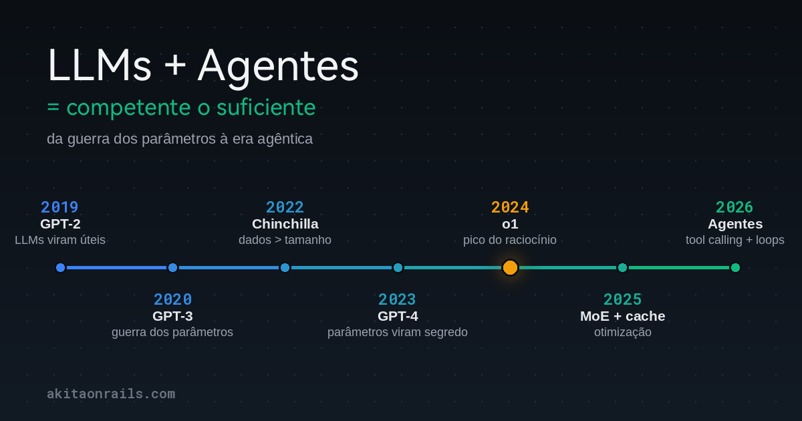

Este texto é uma síntese. Ele amarra numa narrativa só o que eu venho escrevendo e medindo ao longo de 2026, então vale o mapa do caminho antes do argumento:

- **[Novos benchmarks v4](/2026/09/23/llm-benchmark-v4-opus-5-5-gpt-6-sol-luna-mimo-2-6-grok-4-7/)**: retestei os principais modelos e a conclusão incômoda foi convergência, não salto.
- **[Os limites das LLMs](/2026/09/28/llms-sao-boas-em-reproduzir-o-que-existe-e-coisas-novas/)**: modelos são ótimos reproduzindo o que existe, caríssimos no que não existe, e o modelo servido é um arquivo estático que não aprende nada com a sua maratona.
- **[Existem linguagens melhores pra programar com LLMs?](/2026/10/11/existem-linguagens-melhores-pra-programar-com-llms/)**: não. Nem concisão de script nem tipagem forte mudaram o resultado; disciplina de teste mudou.
- **[Qual modelo de decisão tipo Jev é melhor?](/2026/10/10/qual-modelo-de-decisao-classificador-de-ia-tipo-jev-e-melhor/)**: 21 configurações de classificadores, e os próprios "modelos especializados" convergiram pra dentro de alguns pontos uns dos outros.
- **[Clean Code pra agentes de IA](/2026/04/20/clean-code-para-agentes-de-ia/)**, **[VS Code é o novo cartão perfurado](/2026/04/11/vs-code-e-o-novo-cartao-perfurado/)**, **[minhas skills](/2026/09/17/falando-um-pouco-sobre-minhas-skills-de-ia/)**, **[o hot take contra loop engineering](/2026/08/18/hot-take-harness-loop-engineering-graph-engineering-sao-bullshit/)** e **[boas práticas mínimas](/2026/05/30/boas-praticas-projetos-codigo-aberto-llm-o-minimo/)**: a mesma tese por outros ângulos. O modelo é commodity; a engenharia em volta é o diferencial.

A tese que fecha esse arco: **os LLMs chegaram, ou estão pertíssimo de chegar, no teto da arquitetura transformer.** E a boa notícia é que não precisa mais que isso.

## Convergência, não salto

Nos meus benchmarks, não vejo melhora relevante de programação geral desde a geração do Opus 4.5. Sim, Fable e Astra são ótimos em problemas específicos. Em programação geral, o que eu meço é todo mundo espremido no mesmo patamar, incluindo as ofertas comerciais chinesas (Kimi, GLM, DeepSeek). A escolha de modelo virou quase indiferente.

O que ainda faz diferença de verdade é o nível de esforço: effort baixo pra tradução e sumarização, effort alto pra varredura de vulnerabilidade, correção de bug pesado ou otimização. Fora isso, os números contam uma realidade bem mais chata que [a propaganda dos provedores](/2026/09/09/propagandas-enganosas-da-openai-anthropic-nvidia/).

> Minha leitura da linha do tempo: o raciocínio "core" dos modelos teve o último salto grande em 2024. 2025 foi o ano de otimizar a arquitetura. 2026 é o ano de refinar o harness. A inteligência de base não deu nenhum salto de ordem de magnitude nesse período; a eficiência e a competência em sessão longa deram.

## A linha do tempo, com recibos

**2019: GPT-2 prova que LLM é útil.** 1,5 bilhão de parâmetros, resumindo, traduzindo e respondendo sem treino específico, zero-shot. A OpenAI achou tão impressionante que [segurou o modelo completo por meses](https://openai.com/index/better-language-models/) com medo de mau uso. Hoje parece fofo.

**2020: GPT-3 abre a guerra dos parâmetros.** [175 bilhões](https://arxiv.org/abs/2005.14165), cem vezes o GPT-2, e o few-shot in-context learning que virou o paradigma. A [lei de escala do Kaplan](https://arxiv.org/abs/2001.08361), publicada meses antes, dizia que perda caía em lei de potência com tamanho, e a indústria leu como "quanto maior, melhor". Lá se foram dois anos de quem-tem-mais-parâmetro.

**2022: Chinchilla recalibra a guerra.** O DeepMind treinou [400 modelos e mostrou](https://arxiv.org/abs/2203.15556) que os gigantes estavam sub-treinados: um modelo de 70B com 1,4 trilhão de tokens batia o Gopher de 280B. O eixo "dados de treino" passou a pesar tanto quanto o eixo "parâmetros". Primeira rachadura na guerra.

**2023: GPT-4 encerra a guerra por decreto.** O [relatório técnico](https://arxiv.org/abs/2303.08774) recusou publicar tamanho, hardware ou dados, citando o cenário competitivo e as implicações de segurança. O vazamento mais citado, da [SemiAnalysis](https://newsletter.semianalysis.com/p/gpt-4-architecture-infrastructure), descreveu 1,76 trilhão de parâmetros em mistura de especialistas. Desde então, contagem de parâmetros sumiu do marketing: nem os anúncios do GPT-5 nem os do Claude 4 citam número. Repara que nem Astra nem Fable, hoje, gastam uma linha com isso. A guerra acabou e ninguém assinou armistício.

**2024: o pico do raciocínio.** O [o1, de setembro](https://openai.com/index/learning-to-reason-with-llms/), marcou esse pico: RL pra produzir cadeias longas de pensamento, e a descoberta de que mais compute em tempo de teste melhora a resposta. Essa é, na minha régua, a última revolução de "inteligência de base".

**2025: otimização de arquitetura.** A mistura de especialistas virou padrão: o [Mixtral](https://mistral.ai/news/mixtral-of-experts/) já mostrava em 2023 que 46,7B de parâmetros totais com só 12,9B ativos por token custavam como um modelo pequeno, e o [DeepSeek-V3](https://arxiv.org/abs/2412.19437) levou isso a 671B totais com 37B ativos, com o treino final saindo por menos de 6 milhões de dólares em GPU-hours a preço de aluguel de H800 (sem contar o R&D anterior). A mágica do MoE é simples: separa capacidade (parâmetros totais, que moram em memória) de custo por token (só os especialistas escolhidos pelo roteador computam). Você paga um modelo de 37B e carrega um de 671B.

Do lado do serviço, o [prompt caching](https://www.anthropic.com/news/prompt-caching) cortou até 90% do custo de contexto repetido (a OpenAI [seguiu dois meses depois](https://openai.com/index/api-prompt-caching/)), as janelas de contexto passaram de 1 milhão de tokens, e técnicas de serving como speculative decoding e PagedAttention multiplicaram a vazão. E o [DeepSeek-R1-Zero](https://arxiv.org/abs/2501.12948) mostrou que RL puro, sem fine-tuning supervisionado, faz raciocínio emergir. Nada disso é "mais inteligência". Tudo isso é a mesma inteligência mais barata, mais rápida e mais estável.

**2026: a era agêntica.** Function calling existe desde [junho de 2023](https://openai.com/index/function-calling-and-other-api-updates/), mas o ponto de virada de ecossistema foi o [MCP da Anthropic](https://www.anthropic.com/news/model-context-protocol) no fim de 2024, que a OpenAI adotou meses depois e que hoje mora na Linux Foundation. Claude Code, Codex e cia. saíram em 2025, e a métrica que importa virou a da [METR](https://metr.org/blog/2025-03-19-measuring-ai-ability-to-complete-long-tasks/): o tamanho de tarefa que um agente completa com 50% de confiabilidade vinha dobrando a cada 7 meses desde 2019. O guia da própria Anthropic sobre [construir agentes eficazes](https://www.anthropic.com/engineering/building-effective-agents) diz o óbvio bem dito: padrões simples e compostáveis, não frameworks mirabolantes.

## Por que o agente permite um modelo menos denso

Aqui está o mecanismo que a maioria das pessoas não para pra pensar. Um modelo sozinho precisa carregar o mundo nos pesos, porque a única chance dele responder é aquela, em uma passada. Um modelo com harness não precisa:

- **Busca e leitura sob demanda.** Com web search e fetch, o conhecimento de baixa prioridade sai dos pesos e vira consulta: o agente puxa pra janela de contexto só quando precisa. O modelo pode ser menos enciclopédico e mais operador.
- **Tentativa e erro controlada.** Sozinho, o modelo precisa adivinhar a resposta certa de primeira. Com agente, ele propõe uma hipótese, implementa, manda testar, recebe o feedback e decide de novo com informação real. Cada ciclo desses é conhecimento novo entrando na sessão sem custar um neurônio de treino.

Os dois mecanismos combatem alucinação de raiz: fetch traz o fato que o modelo não sabe de cor, e o loop de teste pega a invenção antes de ela virar código. É por isso que 2026 **parece** um salto gigante: a combinação modelo+harness ficou muito mais competente, mesmo com a inteligência de base quase parada.

## Nem todo problema precisa de um LLM gigante

A mesma lógica do "menos denso" vale dentro da aplicação. Boa parte do que as pessoas jogam num LLM de chat é classificação disfarçada: rotular ticket, rotear fila, aplicar política. Pra isso existe modelo de decisão especializado, e eu cobri o tema duas vezes: o [hype do Jev](/2026/10/03/entendendo-o-hype-do-jev-pra-que-serve/), com o ensaio do Paulo Câmara sobre por que um classificador é a primeira coisa que um cientista da computação pensa, e o [meu benchmark com 21 configurações](/2026/10/10/qual-modelo-de-decisao-classificador-de-ia-tipo-jev-e-melhor/), onde um 9B da Microsoft empatou com o líder hospedado e um 4B local ficou a poucos pontos, a centavos por dez mil decisões.

O choque de "193x mais rápido" do marketing do Jev só existe porque muita gente usava um LLM gigante como classificador caro e lento. Quando a ferramenta certa entra, o modelo de fronteira some da jogada, e junto com ele o custo, a latência e a alucinação de formato. É a tese deste texto em miniatura: competência não vem de densidade, vem de encaixe.

## O loop que ninguém vê

Tem um detalhe de experiência de usuário nessa história. Numa sessão agêntica boa, o que acontece é semitransparente pra quem pediu a tarefa: o modelo chuta errado, o agente busca a documentação online ou roda o teste de verdade, o erro volta como feedback, e o modelo corrige sozinho. Você vê "tarefa pedida, tarefa entregue". No meio rolaram dezenas de micro-correções que ninguém testemunhou.

Minha aposta: como os agentes são treinados pra encher o contexto quando precisam, nem versões novas de linguagem ou biblioteca confundem mais tanto. O modelo não precisa saber a API de cor; ele consulta, testa e se ajusta no loop. É o que eu vejo nos meus experimentos, da [conversão de ROMs de NES pra Master System](/2026/09/07/desafio-pra-ia-converter-roms-de-nes-pra-master-system-sms/) aos [probleminhas do dia a dia](/2026/07/12/usando-ia-pra-resolver-meus-probleminhas-do-dia-a-dia/). E foi o que o [benchmark de linguagens](/2026/10/11/existem-linguagens-melhores-pra-programar-com-llms/) mediu: sete linguagens saíam praticamente equivalentes, porque o loop equaliza o que o treino deixa desigual.

A ressalva eu também medi. Quando não existe documentação pra buscar nem teste pra validar, o loop gira no vazio: foi o que aconteceu com o [Bend 2](/2026/09/19/nova-linguagem-voltada-pra-ia-bend-2/), linguagem nova demais pra ter corpus, e foi o ponto central do texto sobre [os limites](/2026/09/28/llms-sao-boas-em-reproduzir-o-que-existe-e-coisas-novas/). O mecanismo é potente, mas precisa de oráculo.

E tem recibo de que a base está parada. Em novembro de 2024 a [Reuters](https://www.reuters.com/technology/artificial-intelligence/openai-rivals-seek-new-path-smarter-ai-current-methods-hit-limitations-2024-11-11/) já reportava retornos decrescentes no pré-treino nos três grandes laboratórios. No NeurIPS seguinte, o Sutskever, o cara da tese de escala, declarou que ["pré-treino como conhecemos vai acabar"](https://www.youtube.com/watch?v=WQQdd6qGxNs): os dados públicos acabaram. E o [AI Index de Stanford](https://hai.stanford.edu/ai-index/2025-ai-index-report) mediu o abismo entre o primeiro e o décimo modelo no Chatbot Arena encolhendo de 12% pra 5% em um ano. Isso é convergência, com número.

## A propaganda na direção contrária

Enquanto os números mostram platô, o marketing vende o apocalipse. Eu já dissequei uma semana inteira disso em ["Você é um idiota se acredita nas propagandas enganosas da OpenAI, Anthropic, NVIDIA"](/2026/09/09/propagandas-enganosas-da-openai-anthropic-nvidia/), então aqui vai só o que interessa pra esta narrativa:

- A "prova de Navier-Stokes" da OpenAI foi força bruta agêntica em escala industrial, 130 bilhões de tokens sobre o maquinário de matemáticos humanos, vendida como inteligência emergente.
- O incidente da Hugging Face foi um enxame executando 17 mil tentativas com verificação automática, não um "agente que ganhou consciência e escapou". Tentativa e erro cara, exatamente o mecanismo que eu descrevi aqui.
- O medo é produto: quem vende "minha IA é poderosa demais e pode fugir do controle" está, na mesma frase, pedindo regulação que trava o concorrente menor e inflando a percepção de que o modelo dele é mais capaz que o dos outros.

Os fatos que eu medi apontam o contrário do apocalipse: modelos convergindo, diferenças encolhendo, e o trabalho útil migrando do modelo pro harness. IA descontrolada ganhando consciência não é o que os logs mostram. O que os logs mostram é engenharia.

## "Competente o suficiente"

Não espero outra revolução de raciocínio de ordem de magnitude nessa arquitetura. O que vem é melhoria agêntica incremental: tool calling mais robusto, memória melhor, sessões mais longas, menos alucinação por ciclo de verificação. E o ponto deste texto é que isso já basta.

O que a era agêntica entregou foi a automação da engenharia de software correta: sessões longas e confiáveis de codificação, com teste e feedback, que aceleraram centenas, senão milhares, de projetos open source. [A premissa do deploy mudou](/2026/09/22/parem-de-inventar-desculpas-e-facam-mais-deploy-a-premissa-mudou/) junto. Não é bala de prata. É um compilador novo pra uma disciplina velha: quem tinha processo, teste e invariante documentada colheu; quem tinha só hype continua esperando o próximo modelo resolver.

E pra fechar: não vejo problema nenhum na estagnação dos modelos crus. [Os limites a gente já conhece](/2026/09/28/llms-sao-boas-em-reproduzir-o-que-existe-e-coisas-novas/), e as otimizações de harness logo entram em retorno decrescente também. O que sobra é o que sempre sobrou: técnica de engenharia de software de verdade, com teste automatizado em primeiro lugar, e um engenheiro experiente pilotando. Com isso, o resultado de codificação é excelente hoje, não daqui a uma geração de modelo.

O que não vai existir é mágica pra amador. Pedir qualquer tarefa de código pra agente, sem saber o que está fazendo, não devolve código seguro, otimizado e bem pensado: devolve slop. O agente responde melhor pra quem sabe o que pedir, ou seja, pra quem entende essa arquitetura, os prós, os contras, e sabe contornar as fraquezas e alavancar os pontos fortes da combinação modelo+harness.

Por isso o título. LLM sozinho é um papagaio caro. LLM com agente é competente o suficiente pra trabalhar de verdade. E "competente o suficiente", somado à sua disciplina de engenharia, é tudo que a indústria precisava. O resto é marketing esperando o próximo número mágico de parâmetros que ninguém mais publica.
