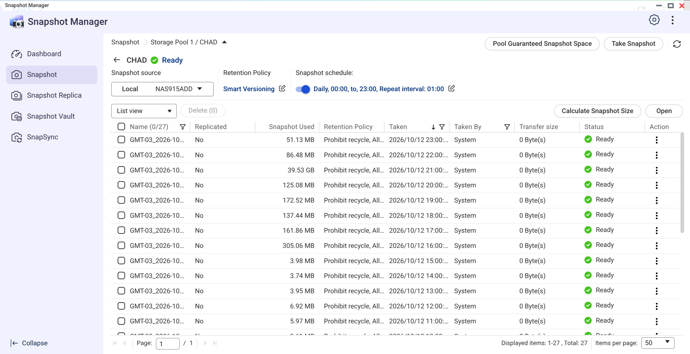
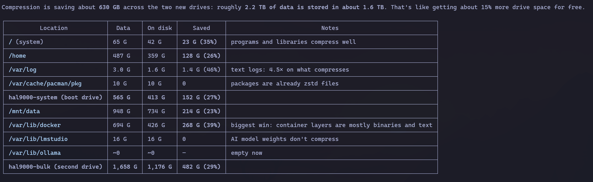

Este texto é continuação direta do [desastre no meu NAS](/2026/10/06/desastre-no-meu-nas-como-quase-perdi-90-tb-de-dados/). Resumo pra quem chegou agora: meu Synology, com oito discos em SHR (paridade simples), perdeu dois discos numa tacada durante um upgrade. Sobrevivi por detalhe de implementação do SHR, comprei um QNAP às pressas, passei uma semana copiando e verificando 91 TB, e não perdi nenhum arquivo por acidente. O QNAP novo roda ZFS em RAID-6; o Synology, refeito, agora roda SHR-2.

Embaixo dessa história toda tem uma decisão que quase ninguém faz conscientemente: **o filesystem**. O Synology usava btrfs o tempo todo. O QNAP usa ZFS. E a sua máquina Linux, muito provavelmente, veio de fábrica com ext4 sem ninguém te perguntar nada. É sobre isso.

## De onde vieram os dois

O ext4 é o final de uma dinastia de mais de três décadas. O ext (extended filesystem) nasceu com o próprio Linux, o ext2 virou padrão nos anos 90, o ext3 adicionou journal em 2001 pra não precisar de fsck épico depois de cada queda de energia, e o ext4 chegou em 2008 com extents, alocação atrasada e volumes de até 1 exbibyte. O objetivo de design sempre foi o mesmo: ser o filesystem padrão, rápido, simples e previsível. Ele é excelente nisso. E parou aí.

O btrfs nasceu em 2007, na Oracle, com o Chris Mason, com um objetivo completamente diferente: ser a resposta do Linux ao ZFS. Em vez de escrever dado por cima de dado, ele é copy-on-write: toda escrita vai pra um bloco novo e os ponteiros são atualizados em cascata na árvore. Essa decisão única é a mãe de tudo que interessa nele.

O que cada um entrega, na lista:

**ext4:**
- journaling (metadados consistentes depois de queda)
- extents e alocação atrasada (boa performance)
- maduro, estável, em todo lugar, qualquer ferramenta funciona

**btrfs:**
- copy-on-write em tudo
- checksum de dados e metadados em cada bloco
- snapshots instantâneos e baratos
- subvolumes independentes dentro do mesmo volume
- compressão transparente (zstd, lzo, zlib)
- RAID nativo e scrub (varredura de verificação)
- send/receive de snapshots pra backup incremental
- reflinks (cópias que não duplicam blocos)

A lista já responde a pergunta do título. Vamos por partes.

## Até o NTFS e o APFS passaram o ext4

E se a comparação com o btrfs parece injusta, olha pro lado. O NTFS nasceu em 1993, com o Windows NT, já com journaling de metadados e ACLs, e ainda nos anos 2000 ganhou o log de todas as mudanças do volume e as cópias de sombra (o "Versões Anteriores" do Windows). O APFS, que a Apple lançou em 2017 feito pra flash, é copy-on-write como o btrfs: snapshots nativos (é o que o Time Machine usa pra restauração local), clones instantâneos de arquivo que compartilham blocos, volumes compartilhando o espaço do mesmo container e criptografia por arquivo.

Leia de novo a lista do ext4 e compare: sem snapshot, sem checksum de dados, sem CoW, sem compressão. O filesystem do Windows e o do Mac, que ninguém considera exemplos de sofisticação, protegem os seus dados melhor que o padrão do Linux, cuja última grande feature saiu em 2008. O btrfs é o que coloca o Linux na mesma geração dos outros dois, e não uma década atrás.

## Por que o btrfs é muito superior

### O que é copy-on-write, pra quem nunca parou pra pensar

Nos filesystems clássicos, a escrita é destrutiva por definição: atualizar um bloco significa gravar o conteúdo novo por cima do velho, no mesmo lugar do disco. Se a máquina morre no meio da escrita, o arquivo fica metade velho, metade novo. O journal do ext3/ext4 cobre isso para os **metadados** (a estrutura de diretórios não corrompe), mas o seu dado em si fica por conta da sorte.

Copy-on-write inverte a ordem: **nada nunca é sobrescrito**. Escrever num arquivo aloca um bloco novo, grava o conteúdo novo ali, e só quando está tudo seguro no disco o filesystem troca os ponteiros pra versão nova, de forma atômica. A qualquer instante, você tem ou a versão velha inteira ou a versão nova inteira. Nunca uma mistura das duas.

O que isso compra na prática:

- **Snapshots quase de graça.** Os blocos velhos já persistem por natureza do CoW; um snapshot é só o filesystem segurando o ponteiro de raiz daquele instante, pura contabilidade.
- **Queda de energia não corrompe.** Uma escrita interrompida deixa a versão anterior intacta, porque ela nunca foi tocada. Pra quem já perdeu imagem de VM ou banco de dados pra queda no meio da escrita, isso vale o filesystem inteiro.
- **Verificação possível.** Como cada bloco é escrito uma vez e nunca mexido, faz sentido guardar checksum dele pra sempre. É a base da proteção contra corrupção que detalho mais abaixo.

O custo existe e eu pago ele sabendo: arquivos de escrita aleatória intensa (disco de VM, banco de dados) fragmentam e duplicam bloco, porque cada reescrita vira um bloco novo. Pra esses casos se desliga o CoW por diretório com `chattr +C`, que precisa ser marcado **antes** do arquivo ser criado. No meu layout, a imagem de VM feita com o `+C` certo ficou saudável; a feita sem virou o caso de fragmentação de livro-texto.

### Snapshots são a feature que muda a sua vida

Snapshot no btrfs é uma foto instantânea de um subvolume, e custa quase nada, porque o CoW já mantém os blocos velhos enquanto alguém referencia eles. Criar um snapshot é operação de segundo, não de horas. Na prática: antes de cada upgrade, o sistema tira uma foto. Se o upgrade quebrar, você não "desinstala pacote": você boota de volta na foto anterior e pronto. A seção de recuperação de boot, mais abaixo, mostra isso acontecendo de verdade.

### Subvolumes são o jeito certo de organizar o disco

Subvolume é um namespace independente dentro do mesmo filesystem, com política própria de snapshot. E tem uma propriedade matadora: **snapshot não é recursivo**. Um subvolume filho dentro de outro fica automaticamente de fora do snapshot do pai.

Eu uso isso pra tudo. No meu desktop, os diretórios de cache que dá pra baixar de novo (mise, rustup, npm, opencode, caches de IA) estão virando subvolumes aninhados dentro do `@home`: ficam no mesmo lugar pra qualquer programa, mas de fora de qualquer snapshot. Só essa separação tira 165 GiB de escopo de snapshot, e os caches grandes (Hugging Face, yay, uv, pip) já moram fora do volume do sistema, com symlinks apontando pra eles: menos 148 GiB de snapshot, parte já migrada e parte em andamento. O snapshot fica pequeno, o restore fica rápido, e o que pode ser rebaixado da internet nunca entra na foto.

O custo real, medido no QNAP novo (ZFS, mas a matemática de CoW é a mesma): 27 snapshots de hora em hora de uma pasta com quase 80 TB, e quase todos consomem megabytes, porque entre uma hora e outra quase nada mudou. Snapshot barato é o que permite essa rotina existir sem culpa.

### Deduplicação por reflink

Antes, a ressalva que importa: o btrfs não tem deduplicação online nativa igual ao ZFS (que mantém uma tabela de dedup em RAM e cobra caro por isso). O que ele tem são duas coisas práticas: **reflink** e dedup offline. Reflink é cópia que compartilha blocos: `cp --reflink=auto` cria um arquivo novo que aponta pros mesmos blocos do original, instantâneo e de graça, e cada um passa a divergir só onde for escrito. Na era de dezenas de checkouts, worktrees e builds parecidos, isso economiza uma montanha de blocos. Pra dedup retroativo existem ferramentas de userspace como [duperemove](https://github.com/markfasheh/duperemove) e [bees](https://github.com/Zygo/bees).

### Proteção contra corrupção de verdade

Todo bloco do btrfs, dado ou metadado, carrega checksum. Quando o filesystem lê e o checksum não bate, ele sabe que o bloco apodreceu, e se houver uma segunda cópia (RAID ou metadata DUP) ele se autocorrige. O ext4 não checa dado nenhum: bit rot passa silencioso até você abrir o arquivo anos depois.

Duas peças da minha configuração mostram o que isso compra na prática, e o que o ext4 simplesmente não oferece. A primeira é o metadado em modo DUP. Num ext4, cada estrutura do volume existe uma vez só: um setor ruim bem posicionado corrompe a tabela de diretórios e o disco inteiro deixa de montar. No btrfs, mesmo com um único disco, todo bloco de metadado existe duplicado. O setor ruim continua existindo, mas o checksum acusa o bloco podre na leitura e a segunda cópia responde no lugar, sem você perceber. É a diferença entre perder o volume e anotar um aviso no log.

A segunda é o scrub mensal. Um ext4 nunca relê nada pra conferir saúde: se um bloco apodrece, você descobre no dia em que alguém tenta abrir aquele arquivo específico, talvez anos depois, quando já não tem conserto. O scrub é uma varredura agendada que relê o volume inteiro validando checksums, e encontra a podridão enquanto ela ainda é pequena e recuperável. Quando o contador do `btrfs device stats` sai de zero, é a sirene pra trocar o disco antes do desastre, não depois.

### Compressão transparente, medida

Todo mount do meu desktop usa `compress=zstd:1`. O nível 1 custa uns pontos percentuais de um núcleo de CPU, e o btrfs detecta o que não comprime (blob de modelo, vídeo) e grava cru, sem custo. O resultado, medido essa semana nos meus dois discos novos:

São **630 GB de espaço grátis** em 2,2 TB: 15% a mais de disco, sem pagar nada. Na migração inicial o ganho foi ainda maior, 45% no volume de sistema, porque havia mais texto e menos binário. Repare nos detalhes da tabela: programas e bibliotecas comprimem bem, camadas de Docker comprimem melhor ainda (39%), log de texto comprime 4,5x, e peso de modelo de IA não comprime nada, o que é esperado e não custa nada. Código-fonte, que é o que mais produzimos na era da IA, comprime lindamente.

## Synology usa btrfs, QNAP usa ZFS

Sendo justo com o ZFS: pra NAS grande ele é superior, e foi o que eu escolhi pro QNAP. Checksum e autocorreção nativos, RAIDZ maduro, send/receive excelente. O preço é complexidade e recurso: o ZFS quer RAM pro cache ARC (meu QNAP tem 7 GB pra um pool de 174 TB, e sinto a falta), a deduplicação online dele precisaria de uns 190 GB de RAM só pra tabela no meu volume, e o modelo de provisionamento dele me deu um susto de graça quando o snapshot foi recusado com 20 TB livres (a história do thick vs thin está no artigo do NAS).

O btrfs é o equilíbrio certo pra máquina de consumo. Leve, nativo no kernel, faz quase tudo que o ZFS faz sem exigir um administrador de storage. Desktop, notebook, homelab, NAS pequeno ou médio: btrfs. O Synology provou na prática, duas vezes: o volume btrfs sobreviveu legível com dois discos fora, e os snapshots dele salvaram 11 álbuns que eu deletei por engano no meio da limpeza, byte a byte.

> NAS grande e sério, com RAM de sobra: ZFS. Todo o resto: btrfs. E pra máquina Linux de uso pessoal, não é nem discussão.

## Recuperação de boot por snapshot

A feature que já me salvou de verdade, contada nas duas máquinas.

No desktop, o [Omarchy](https://omarchy.org) configura o [snapper](https://snapper.io/) pra tirar snapshot antes de cada update e o `limine-snapper-sync` publica cada snapshot como entrada de boot no [Limine](https://github.com/limine-bootloader/limine). Kernel novo não sobe? No menu de boot você escolhe o snapshot de ontem e a máquina volta como se nada tivesse acontecido. Na minha máquina a rotina agendada roda via [Timeshift](https://github.com/teejee2008/timeshift) em cron (a cada boot e de hora em hora), com o snapper cobrindo os pontos de update: o mecanismo de retorno é o mesmo. (A gotcha: cada entrada de snapshot carrega a imagem do kernel junto, então ESP pequena enche rápido. A minha de 1 GB já recusou um update de kernel por falta de espaço; o sistema seguiu bootável no kernel velho, que é o comportamento certo.)

No servidor, que roda [openSUSE MicroOS](https://get.opensuse.org/microos/), é ainda mais forte: o sistema inteiro é btrfs transacional, e cada update é um snapshot novo. Semana passada, o kernel 7.2.9 derrubou o controlador NVMe em silêncio, duas vezes, no meio do backup noturno. O conserto foi um `transactional-update rollback` e um reboot de volta pro 7.2.6, que rodou a carga inteira (754 GiB de leitura de backup com download concorrente) sem um soluço. Regressão de kernel virou reboot agendado, não madrugada de recovery. Uma ressalva documentada: o `/etc` mora dentro do snapshot, então o rollback desfaz mudanças de configuração junto. Depois de qualquer rollback, confira de novo as suas units.

## Manutenção não é opcional (e o arquivo deletado que não some)

Filesystem CoW moderno entrega muito, mas cobra duas rotinas que o ext4 nunca pediu.

A primeira é o scrub, que já apareceu aqui: reler tudo e conferir checksums, mensalmente, em todas as máquinas. Ele é o detector de bit rot em ação, e sem ele o checksum só te avisa da podridão quando você tentar ler o arquivo. O segundo ponto é mais sutil: **snapshot prende bloco de arquivo deletado**. Quando você apaga um arquivo dentro de um subvolume com snapshot, o espaço não volta, porque o bloco continua referenciado pela foto. Foi exatamente o que aconteceu no meu NAS: a limpeza de 2,14 TB que rodei no Synology só liberou espaço de verdade depois que os snapshots velhos foram removidos; até lá, os blocos ficaram presos.

O tratamento é rotina simples. A retenção tem que ser automática, com o snapper ou o Timeshift apagando os snapshots antigos conforme a política (no QNAP, a política de retenção do Snapshot Manager faz o mesmo papel). Espaço que não volta depois de deletar snapshot velho geralmente é chunk alocado demais: um `btrfs balance start -dusage=50` devolve os pedaços pouco usados pro pool livre (aqui em casa eu não agendo balance cego, eu monitoro o espaço não-alocado e ajo quando aperta). E no lado do restic, `forget` sozinho só remove a referência do snapshot: o espaço do repositório só é recuperado com o `prune` junto, `forget --prune`.

## A limpeza da casa na era do AI coding

Agora a parte que quase ninguém conecta com filesystem: a era do agente produz lixo em velocidade industrial. Eu sei porque medi.

- **Rust é o maior poluidor de disco do mundo dev.** Cada build deixa pra trás binários de teste de 100 a 180 MB, e eles se acumulam a cada edição. No meu desktop, os diretórios `target/` somavam **920 GiB**. Só o ai-memory respondia por 704 GiB. A ferramenta de higiene aqui é o [cargo-sweep](https://github.com/holmgr/cargo-sweep), semanal.
- **Docker não fica atrás.** Na minha máquina achei 1,26 TB de build cache mais 938 GB de imagens. Uma faxina única recuperou uns 600 GB. No servidor, a limpeza semanal recolhe de 0,6 a 4,5 GB todo domingo.
- **Caches de IA e de pacotes incham quietos.** O cache do Hugging Face tinha 86 GB até eu apagar três modelos mortos e ele cair pra 21. Pacman tinha 22 GB de pacotes superados. yay, uv e pip, mais 125 GB.
- **E os agentes criam diretórios temporários sem pedir licença.** Projeto complexo com várias branches significa worktrees, e cada worktree de release tem seu próprio `CARGO_TARGET_DIR` cheio de binário de teste. No ai-memory isso já estourou o disco, e virou regra obrigatória no AGENTS.md do projeto: depois de cada release, `cargo clean` em cada worktree criado e remoção dos worktrees terminados, sem exceção.

A solução é automatizar o varrimento. O meu exemplo mínimo, um timer de usuário que roda dia 1 e 15 de madrugada, com Nice e I/O idle:

- apaga diretórios `target/` de projetos parados há mais de 14 dias
- limpa o cache do yay
- poda só o build cache do Docker com mais de 30 dias, nunca imagem ou volume

E a parte que virou padrão aqui em casa: **instruir os agentes a limpar o que criam**. Três regras reais dos meus projetos, pra você copiar:

> **No AGENTS.md do desktop:** "Nunca rode limpezas amplas como `docker system prune` sem autorização explícita do usuário depois de um inventário read-only. Limpeza usa lista exata de IDs; parado, antigo ou sem referência não significa descartável."

> **No CLAUDE.md do homelab:** "Antes de terminar qualquer tarefa, remova as coisas temporárias que a tarefa criou, e só elas. Nunca delete o que você não criou ou não consegue atribuir à tarefa. Na dúvida, liste pro dono."

> **No AGENTS.md do ai-memory:** "`target/` cresce sem limite: cada edição num crate compartilhado deixa pra trás uma cópia de cada binário de teste de 100-180 MB (visto a 157 GiB). `cargo sweep --time 7` semanal, e `cargo clean` obrigatório depois de cada release."

## E o backup de verdade: restic

Snapshot mora no mesmo disco, então snapshot não é backup: se o disco morre, o snapshot morre junto. O último item do kit é o [restic](https://restic.net/), que pra mim é o melhor sistema de backup do Linux hoje.

O restic é um binário único, open source, escrito em Go, que faz backup deduplicado, criptografado e versionado pra praticamente qualquer destino: outro diretório, outro NAS via SFTP ou REST, S3, Glacier. O truque central é o content-defined chunking: ele fatia cada arquivo em blocos de tamanho variável definidos pelo conteúdo, tira o hash de cada bloco e só grava no repositório os blocos que ainda não existem lá. Por isso o delta é barato: o backup de hoje carrega os blocos que mudaram desde ontem, não os arquivos que mudaram. Editar um banco de 100 GB no meio custa alguns megabytes de backup, não 100 GB de novo. Cada execução vira um snapshot do repositório, um ponto de restauração que você navega com `restic mount` como se fosse filesystem, e o `restic check` audita a integridade do repositório inteiro quando você pedir.

A configuração importa mais que a ferramenta, então vai a nossa, com os erros inclusos. No desktop, o repositório mora no NAS e a retenção é `keep-daily 7, keep-weekly 4, keep-monthly 6, keep-yearly 1`. No servidor, o backup roda diário de madrugada pro repositório no QNAP, cobrindo `/etc`, `/usr/local/bin`, `/home` e os volumes dos containers, com a senha fora da máquina e `pg_dump` antes dos bancos, porque snapshot de filesystem não garante consistência de banco escrevendo. A primeira carga completa foi 729 GiB em menos de uma hora, e o restic atravessou ileso, na base do retry, a janela em que a montagem NFS ficou read-only por engano durante a migração.

A parte mais importante da configuração é o que **não** entra no backup. As nossas exclusões, todas com motivo:

- caches de modelo de IA (Immich, Hugging Face, EasyOCR): se perder, baixa de novo;
- métricas do Prometheus: histórico que se regenera sozinho;
- o banco do Fulcrum: reindexa a partir do bitcoind;
- os pesos dos classificadores de decisão: rebaixáveis por hash de revisão (e o glob dessa exclusão vai entre aspas dentro do array do bash, porque sem aspa ele vira fonte de backup em vez de exclusão);
- `node_modules`, `target/`, registry do cargo, toolchains do rustup: build artifact puro.

E um aprendizado de retenção pra fechar. Quando encurtamos a política do servidor pra "ontem, 2 diários, 2 semanais e 1 mensal", a tradução correta pros flags é `--keep-daily 3 --keep-weekly 3 --keep-monthly 2`, não 2/2/1: os níveis do restic se sobrepõem, e o snapshot de ontem também é o mais novo desta semana e deste mês, então cada número precisa ser um a mais que os pontos antigos que você quer guardar. O detalhe pegou a gente no contrapé: o script estava com 2/2/1 literal, e com ele o nível mensal nunca seguraria nada mais velho que a noite passada. Na prática, a intenção era guardar 5 pontos de restauração, e o 2/2/1 entrega só 3: ontem, mais um diário, mais um semanal. Erramos, medimos, corrigimos.

Uma nota de humildade vinda do desastre: os repositórios antigos ficaram no Synology por decisão minha (quase 2 TB de histórico abandonado, porque o conteúdo já estava re-coberto no QNAP novo). Repositório de backup também envelhece, e revisitar o escopo dele faz parte da higiene.

## Conclusão: na era da IA, disco não é detalhe

Agentes codificando o dia inteiro mudam a matemática do armazenamento nas duas pontas. Na ponta do volume: builds, caches, worktrees e modelos enchem o disco muito mais rápido do que qualquer hábito humano enchia, e sem rotina de limpeza você descobre quando estoura. Na ponta da segurança: quanto mais código gerado, mais você precisa de ponto de retorno barato, porque nem toda mudança de agente é boa.

O btrfs cobre as duas. A compressão transparente devolve 15% de disco de graça, e código-fonte é exatamente o tipo de dado que mais comprime. Snapshots e subvolumes te dão volta atrás instantânea no sistema e isolamento do que não precisa de proteção. Checksums e scrub vigiam a saúde dos blocos que o ext4 simplesmente ignora. O ext4 teve seus 15 anos de reinado merecido. Em 2026, escolher ele num Linux novo é abrir mão de proteção que você vai precisar, cedo ou tarde. Escolha btrfs e configure a limpeza hoje.
