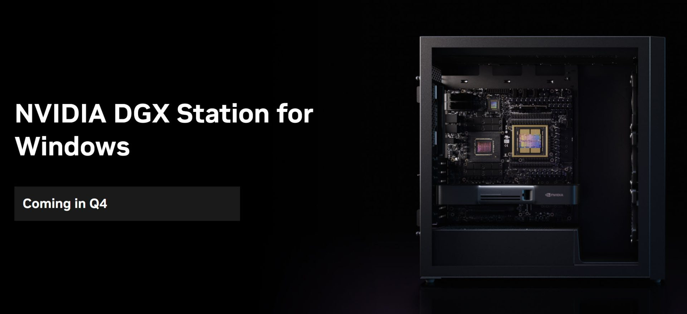
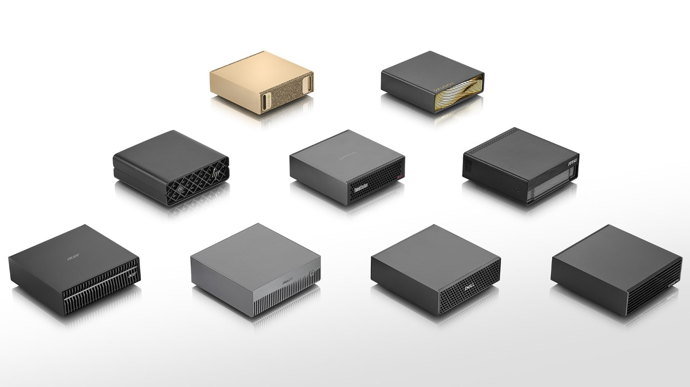

Nos dois últimos artigos eu cobri o [benchmark numa B300 única](/2026/10/19/llm-benchmark-v4-os-top-llms-open-source-numa-b300/) e o [ranking dos modelos grandes em 4x B300](/2026/10/22/llm-benchmark-v4-open-source-que-so-cabe-em-4x-b300/). A pergunta que fecha a trilogia é a da empresa: **vale a pena montar uma infra de LLM própria pro time de desenvolvimento?**

A resposta depende de duas coisas: quantos usuários confortáveis o hardware aguenta, e quanto isso custa por pessoa. Medimos os dois.

## A conta antes do teste

Recapitulando os números do artigo anterior: o pod de 4x B300 custa **US$ 36 por hora** (US$ 864/dia, quase US$ 26 mil/mês ligado direto). Comecei a campanha com uns US$ 127 de saldo, recarreguei US$ 2.550, e sobraram US$ 537. Foram **uns US$ 2.140** entre setup, downloads, tuning e benchmarks, não só inferência.

No meio, o saldo zerou, o pod morreu durante um autotune, e na hora de recarregar **não havia B300 disponível**. É o risco operacional da Runpod: o preço muda e a oferta some. A alternativa foi um pod de 4x H200, com preço de tabela na casa de [US$ 3,59 por GPU-hora na Community Cloud](https://www.runpod.io/pricing): US$ 14,36/hora pras quatro na conta de tabela, contra US$ 36 das B300.

## B300 e H200 não são a mesma máquina

A diferença de hardware muda mais que o preço:

| | 4x B300 | 4x H200 |
| --- | --- | --- |
| Arquitetura | Blackwell Ultra (`sm_103a`) | Hopper (`sm_90`) |
| VRAM | ~288 GB por GPU, ~1,1 TB total | ~141 GB por GPU, ~560 GB total |
| Formatos nativos | FP8 e FP4/NVFP4 | FP8 (sem FP4 nativo) |
| Toolchain | CUDA 12.9+ e kernels compilados na hora | mais maduro, mas ainda com remendos de JIT |

A troca teve custo de adaptação: o checkpoint NVFP4 do GLM que rodava na B300 não existe pra Hopper, então foi preciso baixar a variante FP8 dele, e mesmo o DeepSeek precisou de ajuste de kernel. Os resultados de concorrência abaixo são com os dois em FP8 nativo, que é a comparação justa possível.

## Como medimos "cabe um time"

O teste usa `vllm bench serve` contra o localhost de cada pod, com requisições de 8.000 tokens de entrada e 800 de saída (uma carga sintética no formato de sessão de codificação), subindo a concorrência N degrau por degrau.

O critério de conforto é o que importa: **TTFT de até 2 segundos e TPOT de até 20 ms por token** (ou seja, pelo menos 50 tokens/s por stream), com **95% ou mais das requisições** cumprindo os dois limites. Não é "a mediana ficou boa": é quase todo mundo bem atendido. Um time que espera 50 segundos pelo primeiro token não é um time, é uma fila.

E o aviso de honestidade: isso mede requisições de código confortáveis, não pessoas. Não tenho um multiplicador medido de duty-cycle de agente interativo, então não vou inventar que cada N vira 2 ou 3 desenvolvedores.

## Os números

| Modelo / hardware | Stream único | Confortável (N) | Porta solta (só mediana) | Pico agregado | Gargalo |
| --- | ---: | ---: | ---: | ---: | --- |
| DeepSeek V4.1 Flash, 4x B300 FP8 | 177 tok/s | **32** | 48 | 2.778 tok/s | prefill (TTFT) |
| DeepSeek V4.1 Flash, 4x H200 FP8 | 137 tok/s | **8** | 16 | 2.506 tok/s | prefill (TTFT) |
| GLM 5.3 Flash, 4x H200 FP8 | 175 tok/s | **8** | 16 | 1.930 tok/s | **KV cache, 97%** |

Leia com calma, porque tem três histórias aqui.

**A B300 atende quatro vezes mais gente no conforto.** Mesmo modelo, mesmo FP8, mesmo TP4: 32 usuários confortáveis contra 8. O agregado da H200 até impressiona (2.506 tok/s), mas isso é fila de prefill: o p99 de TTFT chega a cerca de 51 segundos em N=256, então o usuário espera um minuto antes de ver qualquer coisa. Throughput alto não é capacidade interativa.

O penhasco é tão íngreme que vale olhar os números de perto. Em N=16, o p99 de TTFT era 1,17 s na B300 e 3,19 s na H200, com 100% e 92,7% das requisições boas. Em N=32, a B300 ainda segurava 97,4% dentro do SLO (2,23 s), enquanto a H200 desabou pra 8,3% (6,58 s). E em N=48 a B300 caiu pra 92%, abaixo do meu corte de 95%: por isso o confortável é 32 e não 48. A diferença entre "funciona" e "funciona pra todo mundo" mora nesses últimos 2 pontos percentuais.

**Modelo pesado e leve empatam na H200.** O DeepSeek de 510 GB e o GLM menor sustentam os mesmos 8 confortáveis, por motivos diferentes: o DeepSeek tem KV eficiente via MLA e morre de compute/prefill; o GLM estoura o KV cache (97% de uso). Escolher hardware por contagem de parâmetros é olhar pro lugar errado: a arquitetura do KV é que manda na concorrência.

**A porta solta engana.** Se você olhar só a mediana, dá pra dizer 48 na B300 e 16 na H200. Só que a cauda do p99 destrói a experiência de quem está do outro lado. Pra dimensionar time, uso o número confortável e pronto.

## Custo por usuário confortável

Agora a aritmética que decide:

- **4x B300:** US$ 36/h ÷ 32 = **US$ 1,13 por usuário confortável por hora**.
- **4x H200:** US$ 14,36/h ÷ 8 = **US$ 1,80 por usuário confortável por hora**.

A B300 ganha por pessoa mesmo custando 2,5x mais o pod. A H200 só viraria mais barata por usuário abaixo de US$ 9/hora o pod inteiro, e na tabela atual ela custa US$ 14,36. O ponto de corte não é o preço da máquina, é a capacidade dela.

## E se a sua empresa já vive em AWS ou Azure?

Dá pra montar a mesma infra nos hiperescalares, mas o preço muda de categoria. Os valores de tabela que eu conferi, por GPU-hora:

| Provedor | Configuração | Preço por GPU-hora | Contra Runpod |
| --- | --- | ---: | ---: |
| Runpod, 4x B300 (minha campanha) | B300 | US$ 9,00 | 1x |
| Runpod, 4x H200 (Community Cloud) | H200 | [US$ 3,59](https://www.runpod.io/pricing) | 0,4x |
| [AWS, p6-b300.48xlarge](https://themodelpress.com/gpu-prices) | 8x B300, capacity block | US$ 16,15 | 1,8x |
| AWS, p6-b200.48xlarge | 8x B200, capacity block | US$ 14,21 | 1,6x |
| [Azure, ND96isr_H200_v5](https://themodelpress.com/gpu-prices/azure-nd-h200-v5-on-demand) | 8x H200, East US 2 | US$ 10,60 | 3,0x |

A B300 na AWS custa 1,8x o que eu paguei na Runpod, e a H200 na Azure custa quase 3x a da Runpod. A conclusão de capacidade não muda (a física do tensor parallelism e do KV cache é a mesma), mas a conta de "vale a pena" piora bem: se na Runpod a B300 empata com a assinatura na faixa de 30 usuários, na AWS ela passa a perder por uma margem confortável.

E na prática, quanto sai por desenvolvedor, desligando o pod à noite como nas outras contas (8 horas por dia útil, 176 horas/mês)? As linhas de AWS e Azure são aritmética normalizada pra 4 GPUs, porque os SKUs citados vêm com 8 e eu não medi TP=8:

| Setup | Custo mensal do pod | Streams confortáveis (1 por dev) | Custo por dev/mês |
| --- | --- | ---: | ---: |
| Runpod 4x B300 (US$ 36/h) | US$ 6.336 | 32 | US$ 198 |
| AWS 4x B300 (US$ 64,58/h, normalizado) | US$ 11.367 | 32 | US$ 355 |
| Runpod 4x H200 (US$ 14,36/h) | US$ 2.527 | 8 | US$ 316 |
| Azure 4x H200 (US$ 42,40/h, normalizado) | US$ 7.462 | 8 | US$ 933 |

A diferença é brutal: o mesmo desenvolvedor confortável sai por US$ 198 na Runpod e por US$ 933 na Azure, quase cinco vezes mais caro que a assinatura de frontier mais forte. A AWS fica quase 80% acima da Runpod, então mesmo ela só faz sentido se a sua exigência for outra coisa que não custo.

E se você pegar a instância inteira de 8 GPUs, como elas são vendidas? A AWS sai por US$ 22.734/mês e a Azure por US$ 14.925/mês, e aí você tem que medir TP=8 pra saber quantos usuários aproveita, porque com TP=4 você paga o dobro pela mesma capacidade.

Os modelos comerciais também são diferentes: capacity block na AWS não é on-demand, e a Community Cloud da Runpod não é SLA de produção. Leia essa tabela como ordem de grandeza de preço, não como cotação de contrato. Se a sua exigência é compliance, procurement ou residência em região específica, o hiperescalar pode ser inevitável, e aí você paga o prêmio. Se a exigência é só preço, as neoclouds ganham nessas configurações.

## E se em vez de alugar, eu comprar a máquina?

Quando a conta de aluguel dói, a pergunta natural é comprar o hardware. Dois candidatos da prateleira atual:

**DGX Station GB300** (~US$ 130 mil, com configurações começando em torno de US$ 95 mil): 748 GB de memória unificada (252 GB de HBM3e a 7,1 TB/s e 496 GB de LPDDR5X a 396 GB/s), 20 PFLOPS em FP4. Os pesos de todos os modelos que eu testei cabem nela, e os melhores pra colocar nela seriam:

- **DeepSeek V4.1 Flash** (92,5/A, 510 GB em FP8), o campeão do benchmark;
- **Muse Spark Open** (69,5/C, 533 GB em NVFP4);
- **Step-5-Preview** (72,5/C, 368 GB em NVFP4);
- **GLM 5.3 full** (76/B, 704 GB em FP8).

Cabe, mas caber não é servir: o GLM full deixaria só uns 44 GB pra KV cache e sistema, então a concorrência plena com contexto longo fica por medir. A estimativa de conforto é de um dígito, na linha da H200, e não os 32 do pod de quatro. A diferença é que você não precisa de TP=4: tudo mora num chip só.

**DGX Spark** (~US$ 6.950 na loja atual da NVIDIA): 128 GB unificados, 1 PFLOP em FP4, 273 GB/s de banda. O recheio bom pra ela é de modelo pequeno e médio, e ele é melhor do que parece:

E tem um detalhe que dói de ver na fatura: por estimativa minha, sem auditoria fechada de todos os custos da primeira rodada, somando os créditos do v4 (aqueles ~40 modelos comerciais) com os US$ 2.140 desta campanha de B300/H200, eu já gastei alguns mil dólares entre API e pods, perto de metade do preço de uma DGX Spark. E ainda assim eu não teria uma máquina guardada em casa por causa disso.

- **Qwen3.8 Flash-Next** (92,5/A), o co-líder da B300 única. Em IQ3_S ele fica na casa de dezenas de GB, e foi exatamente o modelo que fez 91,0 na RTX 5090 com Strata. É o melhor modelo que eu recomendaria pra uma Spark hoje.
- **Swift 1.5 27B** (88/A, 56 GB), que foi a recomendação de self-host mais equilibrada da minha campanha anterior;
- **ThinkingCap 3.8 27B** (83/A, 56 GB);
- **Ornith-1.5-35B-A3B** (81/B, ~70 GB em BF16);
- **Laguna-S-2.1** (65,5/C, 99,7 GB em NVFP4);
- e os classificadores pequenos do benchmark de decisão (Jebadiah 4B, Laya, Julia), que são o caso de uso ideal de uma caixa dessas.

O DeepSeek V4.1, com 510 GB, não cabe de jeito nenhum. A banda é quase 30 vezes menor que a da B300, então a interatividade sofre, e a concorrência prática fica pra medir: eu espero pouco mais que uso solo. Pra modelo pequeno é uma caixinha simpática; pra monstro, é peso de papel.

### TCO, ROI e depreciação

A conta de ter versus alugar, usando 3 anos de depreciação e o mesmo padrão de uso (8 horas por dia útil, 176 horas/mês):

| Cenário | Custo de alugar/mês | Custo de comprar (depreciação/mês) | Break-even |
| --- | --- | ---: | ---: |
| GB300 vs Runpod 4x B300 (US$ 36/h) | US$ 6.336 | US$ 3.611 (130 mil / 36) | **~20 meses** |
| GB300 vs Runpod 24/7 | US$ 25.920 | US$ 3.611 | ~5 meses |
| Spark vs 1x B300 (US$ 9,09/h) | US$ 1.600 | US$ 193 (6.950 / 36) | **~4 meses e meio** |
| Spark vs assinatura de US$ 200 | US$ 200 | US$ 193 | ~3 anos |

Leitura: se você roda modelo grande todo dia útil por dois anos ou mais, o GB300 se paga em menos de dois anos, e em 24/7 ele se paga em cinco meses. Se a sua necessidade é uma campanha de duas semanas como a minha, alugar custou US$ 2.140 e pronto, sem ativo parado depois. E o Spark só faz sentido se a sua carga for modelo pequeno: nesse caso ele se paga em menos de um semestre contra aluguel e em três anos contra assinatura, mas se a sua necessidade é um 748B, ele é inútil desde a caixa.

Duas ressalvas pra não comprar errado. Primeiro, a tabela compara cenários de dólar, não ROI de carga equivalente: se a sua concorrência real no GB300 for de um dígito, a comparação honesta seria com um pod menor que o de 4x B300. Segundo, energia e administração mudam o resultado, principalmente no Spark, onde a diferença pra assinatura fica em poucos dólares por mês. Ignorei revenda no fim dos três anos; se ela existir, o break-even melhora.

**Nota pra quem compra no Brasil:** esses preços são em dólar. Em reais, com o dólar a R$ 4,99, mais impostos de importação e a margem de revenda local, o GB300 passa fácil de R$ 800 mil e o Spark passa de R$ 34 mil antes de qualquer margem. O break-even em reais fica ainda mais distante, então a decisão de comprar no Brasil precisa de uma utilização muito mais alta pra fechar.

E comparando com assinatura de frontier? Um plano forte de Claude/Codex custa uns US$ 200 por mês por desenvolvedor. Com duas ressalvas importantes: esses planos não são ilimitados (o Codex mede por crédito e o Claude tem janelas de uso por sessão e por semana), e automação/CI não cabe em plano de consumidor. A comparação abaixo é de preço, não de carga equivalente. Pra transformar stream em gente eu preciso de uma premissa: um desenvolvedor com uma requisição ativa o tempo inteiro durante o expediente, o que é otimista pra capacidade e conservador pra custo. Com essa premissa, e sem contar minha hora de sysadmin nem o setup, o pod rodando 8 horas por dia útil (176 horas/mês) fica assim:

| Setup | Custo mensal do pod | Streams confortáveis (1 por dev) | Custo por dev/mês |
| --- | ---: | ---: | ---: |
| 4x B300 | US$ 6.336 | 32 | **US$ 198** |
| 4x H200 | US$ 2.527 | 8 | **US$ 316** |
| 4x B300 ligado 24/7 | US$ 25.920 | 32 | US$ 810 |

Na faixa de 30 streams contínuos, a B300 fica praticamente no preço da assinatura forte. Abaixo disso, a assinatura sai mais barata, porque você paga por pessoa, não por hora de pod ociosa. E ligar 24/7 sem carga correspondente é jogar dinheiro fora: o pod cobra dormindo.

## Pra empresa, quando fecha a conta

Se você tem um time grande de verdade usando o dia inteiro, dados que não podem sair do ambiente, e um modelo que entrega no trabalho diário (o DeepSeek V4.1 Flash fez 92,5 no meu benchmark de vigilância, acima do GPT-6 Sol e do Sonnet 5), a infra própria começa a fazer sentido **pela primeira vez sem ser vaidade**. O ponto de corte, na premissa de um stream ativo por pessoa o expediente inteiro, fica na casa das 30 pessoas concorrentes, com o pod desligando fora do horário.

Se o time é pequeno, o uso é intermitente, ou o objetivo é só economizar: continua com a API. O mesmo DeepSeek custou US$ 1,21 por rodada completa de benchmark na nuvem, e você não herda um pod pra administrar, nem o risco de a B300 sumir do estoque quando você mais precisa.

O que eu levo dessa campanha: hardware grande não é resposta pra pergunta pequena. Antes de assinar o pod, faça a conta de quantas pessoas realmente concorrem no seu time, meça a latência que elas toleram, e some o preço da sua hora de sysadmin. O modelo aberto grande já chegou na faixa de Sonnet 5 e GPT-6 Sol pra revisão diária de código. A infra só precisa caber no orçamento.
